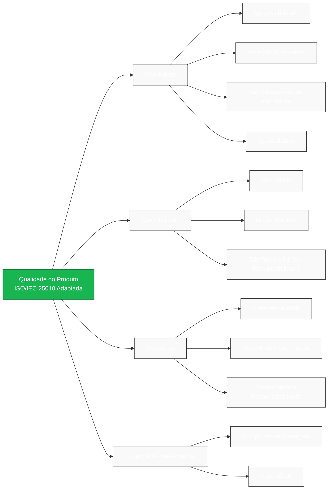

# Fase 1: Requisitos de Avaliação

## 1. Propósito da avaliação
O propósito desta avaliação é analisar a qualidade do portal "Agência Virtual da Neoenergia Brasília", com o objetivo de identificar pontos de melhoria, gargalos de desempenho e compreender o comportamento prático do sistema diante de cenários reais de uso.

A avaliação está sendo conduzida de forma independente por estudantes de Engenharia de Software da Universidade de Brasília (UnB), atuando como avaliadores e auditores de qualidade. O público-alvo desta documentação inclui a comunidade acadêmica e profissionais interessados no controle de qualidade de serviços públicos digitais.

Os resultados obtidos serão consolidados em um relatório técnico-acadêmico. Este documento será utilizado para fornecer um diagnóstico fundamentado sobre a maturidade do portal, servindo como base empírica para evidenciar falhas e propor adequações estruturais, de interface e de regras de negócio com base na família de normas SQuaRE. Como embasamento teórico, a análise será focada nas visões de qualidade do usuário (adequação ao uso) e do produto (atributos internos e externos), conforme definidas por Garvin (1984).

---

### **1.1. Requisitante e Partes Interessadas (Stakeholders)**

A definição clara dos envolvidos é fundamental, pois os objetivos e os requisitos da avaliação dependem da necessidade do solicitante e das partes impactadas pelo sistema (Ramos, 2026). Neste projeto, os papéis e influências estão mapeados da seguinte forma:

* **Requisitante (Equipe de Avaliação):** Estudantes da disciplina de Qualidade de Software da Universidade de Brasília (UnB). Atuam como uma equipe de avaliação independente (representando a "comunidade de software" e "laboratórios de avaliação"), cuja necessidade é aplicar, identificar e validar métodos empíricos de avaliação da qualidade, aumentando a credibilidade das técnicas estudadas em cenários reais.

* **Usuários Finais (Clientes residenciais e corporativos):** São os cidadãos do Distrito Federal que utilizam a plataforma para gerenciar serviços de energia. A sua principal necessidade é ter confiança no produto, além de exigir uma interface clara e segura. Essa necessidade influencia diretamente a atribuição de **ênfase máxima (5) para Usabilidade e Segurança** em nosso modelo de avaliação.

---

## **2. Produto a ser avaliado**

* **Nome e Categoria do Produto:** Agência Virtual da Neoenergia Brasília. Classifica-se como um **Software Comercial** (Pressman, 2010), organizado em uma plataforma Web para facilitar as operações comerciais, a prestação de serviços ao cliente e a descentralização do atendimento.
* **Principais tarefas e escopo de avaliação:**
    1. Login e Cadastro de Usuário
    2. Emissão de segunda via de fatura
    3. Histórico de consumo
    4. Relatório de Nada Consta
    5. Indicadores de continuidade
* **Perfil dos Usuários:** População em geral do Distrito Federal, abrangendo desde cidadãos leigos até usuários com alto conhecimento em informática. Tal heterogeneidade exige forte ênfase na Engenharia Humana e Usabilidade (Galin, 2018).

* **Descrição e Módulos do Sistema:** O escopo do sistema submetido à avaliação é composto por múltiplas funções e janelas de interação de dados, logicamente estruturadas nos seguintes módulos principais:

    1. *Módulo de Autenticação e Gestão de Perfil:* Componente responsável pelo Login e Cadastro de Usuário. Atua como a barreira de segurança primária, controlando sessões e permissões de acesso por meio de formulários de entrada de dados.
    2. *Módulo de Faturamento e Cobrança:* Engloba a Emissão de 2ª via de fatura e a geração do Relatório de Nada Consta. Caracteriza-se por interfaces de consulta transacional e exportação de relatórios em formato PDF.
    3. *Módulo de Monitoramento de Consumo e Serviços:* Contempla o Histórico de Consumo e os Indicadores de Continuidade, exigindo interfaces ricas (gráficos e tabelas) para a visualização de métricas ao longo do tempo.

* **Interfaces e Dependências:** A aplicação opera estritamente através de interfaces gráficas de usuário (GUI) baseadas na Web, exigindo como requisito de software o uso de navegadores de internet padrão (browsers). Arquiteturalmente, as operações do sistema possuem forte dependência de integração com o banco de dados corporativo da Neoenergia (back-end) para validar credenciais, recuperar históricos de medição de energia e atestar status de pagamentos em tempo real.

* **Ambiente e Massa de Dados:** Para estabelecer um ambiente de avaliação válido, serão utilizados dados reais de uma unidade consumidora localizada em Taguatinga. Esta massa de dados disponível e fidedigna é essencial para agilizar a avaliação sem causar impactos ou simular falsos positivos.

* **Perfil dos Usuários e Nível de Conhecimento:** O ambiente no qual o produto está inserido abrange a população do Distrito Federal. O sistema exige a interação de usuários com níveis altamente heterogêneos de conhecimento em informática e no domínio do serviço. Tal variação exige forte ênfase na Engenharia Humana durante a avaliação.

---

## **3. Especificar os modelos de qualidade e Adaptação**

A avaliação utilizará o modelo de qualidade de produto definido na norma **ISO/IEC 25010:2011**. O modelo original completo abrange oito características. No entanto, o modelo de qualidade deve ser adaptado ao contexto do software a ser avaliado e aos objetivos definidos pelo requisitante.

**Justificativa da Adaptação:**
Como a avaliação será conduzida por meio de testes de caixa-preta (black-box) em um ambiente de produção externo, sem acesso ao código-fonte ou à infraestrutura de servidores da Neoenergia, o modelo foi adaptado para excluir características puramente internas (como Manutenibilidade, Portabilidade e Compatibilidade). O foco foi direcionado estritamente para as características dinâmicas e operacionais perceptíveis pelo usuário final e críticas para o negócio.

**Representação Gráfica do Modelo Adaptado:**
Abaixo apresenta-se a estrutura em árvore do modelo de qualidade adaptado para o escopo desta avaliação:

_Fonte: Dara Maria, 2026_
---

### **3.1 Seleção e Priorização das Características (Justificativa de Ênfase)**

A seleção das características e a atribuição de seus respectivos níveis de ênfase (onde 1 representa nenhum interesse e 5 representa grande interesse) foram pautadas pelo perfil dos usuários finais e pela criticidade do domínio da aplicação (serviços de utilidade pública).

A tabela a seguir consolida as prioridades e suas justificativas:

| Característica (ISO/IEC 25010) | Ênfase (1 a 5) | Nível de Prioridade | Justificativa da Atribuição |
| --- | --- | --- | --- |
| **Usabilidade** | **5** | Máxima | A Agência Virtual atende a toda a população do DF, cujo nível de conhecimento em informática é altamente variável. O sistema deve ser intuitivo para garantir que cidadãos leigos consigam operá-lo sem auxílio externo, evitando a superlotação no atendimento presencial.|
| **Segurança** | **5** | Máxima | O portal processa e expõe dados sensíveis (cadastrais, endereços) e informações financeiras (faturamento). A garantia da confidencialidade e integridade é mandatória para evitar fraudes, acessos indevidos e adequar-se às legislações. |
| **Confiabilidade** | **4** | Alta | A indisponibilidade impede os clientes de realizarem pagamentos no prazo. A tolerância a falhas é crucial para que, diante de um erro de comunicação ou dado inválido, o sistema informe o usuário de forma clara sem corromper a sessão. |
| **Eficiência de Desempenho** | **4** | Alta | O tempo de resposta afeta diretamente a percepção de usabilidade. A geração de relatórios e gráficos de consumo exige processamento que não deve exceder limites aceitáveis de espera para garantir a fluidez da navegação. |
| **Manutenibilidade, Portabilidade e Compatibilidade** | **1** | Nenhuma | A avaliação limita-se a uma abordagem externa (caixa-preta), impossibilitando a medição de atributos de código-fonte, infraestrutura ou arquitetura interna pelos avaliadores. |

_Fonte: Equipe Radia Perlman, 2026_

---

### **Procedimentos de Avaliação e Níveis de Ênfase**

Abaixo estão detalhados os procedimentos de avaliação por característica, pontuados em uma escala de ênfase de 1 a 5, com o mapeamento explícito das funcionalidades do escopo escolhidas para cada teste:

* **Usabilidade (Ênfase 5):** Capacidade do portal de ser usado com eficácia, eficiência e satisfação no contexto de uso.
    * *Proteção contra erros do usuário:* **Funcionalidade avaliada:** Login/Cadastro. Inserir intencionalmente formatos inválidos no formulário para verificar se o sistema protege o usuário e orienta a correção antes do envio dos dados.
    * *Operabilidade e Apreensibilidade:* **Funcionalidades avaliadas:** Emissão de 2ª via e Histórico de Consumo. Executar a navegação até as faturas de energia e gerar o gráfico de consumo, medindo se os atributos do sistema o tornam fácil de operar e controlar por usuários leigos.
    * *Reconhecimento da adequação:* **Funcionalidades avaliadas:** Relatório de Nada Consta e Indicadores de Continuidade. Avaliar se as telas permitem que o usuário reconheça imediatamente que as funções são apropriadas e suficientes para suas necessidades de informação.

* **Confiabilidade (Ênfase 4):** Desempenho de funções sob condições especificadas e por um período determinado.
    * *Disponibilidade:* **Funcionalidades avaliadas:** Emissão de 2ª via e Relatório de Nada Consta. Monitorar a proporção de tempo em que essas funções permanecem operacionais e acessíveis.
    * *Maturidade, Tolerância a falhas e Recuperabilidade:* **Funcionalidade avaliada:** Histórico de Consumo. Interromper intencionalmente parâmetros de rede durante o carregamento dos gráficos para verificar se o sistema opera como pretendido, restabelece o estado desejado ou recupera dados afetados.
    * *Nota de Escopo:* As funcionalidades de *Login/Cadastro* e *Indicadores de Continuidade* não são o foco primário das métricas de confiabilidade desta avaliação. O impacto crítico de falhas e indisponibilidade para o cliente e para a concessionária reside na impossibilidade transacional de pagar contas (2ª via) ou comprovar adimplência (Nada Consta).

* **Segurança (Ênfase 5):** Proteção de informações e controle de acesso apropriado à autorização.
    * *Autenticidade e Responsabilização:* **Funcionalidade avaliada:** Login/Cadastro. Validar os mecanismos de login para garantir que a identidade alegada pelo usuário possa ser provada e que as ações sejam rastreadas unicamente àquela entidade.
    * *Confidencialidade:* **Funcionalidades avaliadas:** Emissão de 2ª via e Histórico de Consumo. Verificar se os dados financeiros e de faturamento estão acessíveis apenas após a autenticação correta.
    * *Integridade e Não repúdio:* **Funcionalidade avaliada:** Relatório de Nada Consta. Emitir o relatório e avaliar os mecanismos que previnem a modificação não autorizada do documento e provam que a emissão ocorreu de forma incontestável.
    * *Nota de Escopo:* A funcionalidade *Indicadores de Continuidade* não se encaixa na avaliação de Segurança. Por se tratar de dados de transparência pública (métricas de qualidade do fornecimento de energia da região), ela não expõe informações pessoais, financeiras ou sigilosas que demandem validação de confidencialidade ou integridade restrita do usuário.

* **Eficiência de Desempenho (Ênfase 4):** Desempenho relativo aos recursos utilizados nas operações.
    * *Comportamento temporal:* **Funcionalidades avaliadas:** Login/Cadastro e Indicadores de Continuidade. Cronometrar os tempos de resposta e as taxas de processamento ao submeter o formulário de credenciais e ao requisitar o painel de métricas da rede.
    * *Capacidade:* **Funcionalidades avaliadas:** Emissão de 2ª via e Histórico de Consumo. Avaliar como o sistema responde sob estresse de pico, verificando se a geração de arquivos PDF e a renderização pesada de gráficos atendem aos requisitos de navegação fluida.
    * *Nota de Escopo:* O *Relatório de Nada Consta* não foi selecionado como alvo principal de medição de desempenho, pois sua emissão é esporádica se comparada ao altíssimo volume de concorrência e requisições simultâneas enfrentadas pela emissão de faturas mensais e consultas de consumo.

---

## Referências Bibliográficas
* GALIN, D. *Software Quality: Concepts and Practice*. IEEE Computer Society, John Wiley & Sons, 2018.
* GARVIN, D. A. *What Does "Product Quality" Really Mean?*. Sloan Management Review, Fall 1984.
* ISO/IEC 25010:2011. *Systems and software engineering — Systems and software Quality Requirements and Evaluation (SQuaRE) — System and software quality models*.
* PRESSMAN, R. S. *Software Engineering: A Practitioner's Approach*, 7 ed., McGraw Hill, 2010.

## Histórico de Versões

| Versão | Data | Descrição da Alteração | Autor(a) |
|---|---|---|---|
| 1.0 | 16/10/2026 | Criação do documento inicial de Fase 1 | Dara Maria Barbosa de Sousa |
| 1.1 | 16/10/2026 | Remoção de Mitigação de Riscos e refatoração de formatação | Dara Maria Barbosa de Sousa |
| 1.2 | 19/10/2026 | Adição da seção de Requisitantes e partes interessadas;   Descrição dos modulos do sistema;  Adição da Justificativa da Adaptação.| Dara Maria Barbosa de Sousa |