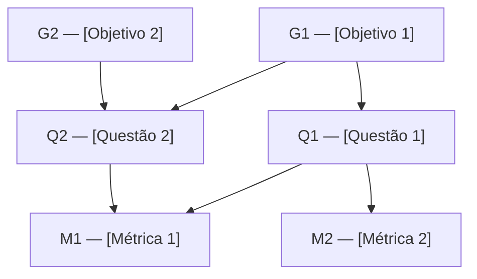

---
hide:
  - toc
---

# Gráfico GQM

O diagrama abaixo representa a hierarquia completa da especificação, do nível **conceitual** (Objetivos) ao **operacional** (Questões) e ao **quantitativo** (Métricas).

## Matriz de rastreabilidade

| Objetivo | Questão  | Métrica |
|----------|---------|----------|
| [G1](objetivos.md#g1) | [Q1](questoes-hipoteses.md) | [M1](metricas.md#m1) |
| [G1](objetivos.md#g1) | [Q1](questoes-hipoteses.md) | [M2](metricas.md#m2) |
| [G1](objetivos.md#g1) | [Q2](questoes-hipoteses.md) | [M1](metricas.md#m2) |
| [G2](objetivos.md#g1) | [Q2](questoes-hipoteses.md) | [M1](metricas.md#m2) |

