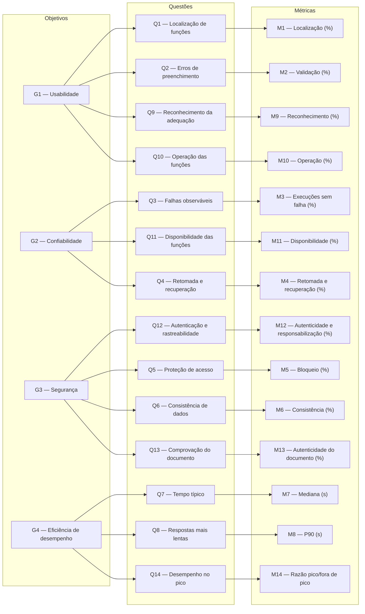

# Gráfico GQM

Organizamos no diagrama os quatro objetivos definidos a partir da Fase 1. De cada objetivo partem duas questões, associadas às métricas de medição. As hipóteses estão reunidas na página de [questões e hipóteses](questoes-hipoteses.md).

*Figura 1 — Relações entre objetivos, questões e métricas da avaliação da Agência Virtual da Neoenergia Brasília.*

## Matriz G–Q–H–M

| Objetivo | Subcaracterística | Questão/hipótese | Métrica | Unidade |
|---|---|---|---|---|
| [G1](objetivos.md#g1) | Apreensibilidade | [Q1/H1](questoes-hipoteses.md#q1) | [M1](metricas.md#m1) | % |
| [G1](objetivos.md#g1) | Proteção contra erros | [Q2/H2](questoes-hipoteses.md#q2) | [M2](metricas.md#m2) | % |
| [G1](objetivos.md#g1) | Reconhecimento da adequação | [Q9/H9](questoes-hipoteses.md#q9) | [M9](metricas.md#m9) | % |
| [G1](objetivos.md#g1) | Operabilidade | [Q10/H10](questoes-hipoteses.md#q10) | [M10](metricas.md#m10) | % |
| [G2](objetivos.md#g2) | Maturidade | [Q3/H3](questoes-hipoteses.md#q3) | [M3](metricas.md#m3) | % |
| [G2](objetivos.md#g2) | Disponibilidade | [Q11/H11](questoes-hipoteses.md#q11) | [M11](metricas.md#m11) | % |
| [G2](objetivos.md#g2) | Tolerância a falhas / Recuperabilidade | [Q4/H4](questoes-hipoteses.md#q4) | [M4](metricas.md#m4) | % |
| [G3](objetivos.md#g3) | Autenticidade e Responsabilização | [Q12/H12](questoes-hipoteses.md#q12) | [M12](metricas.md#m12) | % |
| [G3](objetivos.md#g3) | Confidencialidade | [Q5/H5](questoes-hipoteses.md#q5) | [M5](metricas.md#m5) | % |
| [G3](objetivos.md#g3) | Integridade / Não repúdio (indireta) | [Q6/H6](questoes-hipoteses.md#q6) | [M6](metricas.md#m6) | % |
| [G3](objetivos.md#g3) | Integridade / Não repúdio | [Q13/H13](questoes-hipoteses.md#q13) | [M13](metricas.md#m13) | % |
| [G4](objetivos.md#g4) | Comportamento temporal | [Q7/H7](questoes-hipoteses.md#q7) | [M7](metricas.md#m7) | s |
| [G4](objetivos.md#g4) | Comportamento temporal | [Q8/H8](questoes-hipoteses.md#q8) | [M8](metricas.md#m8) | s |
| [G4](objetivos.md#g4) | Capacidade | [Q14/H14](questoes-hipoteses.md#q14) | [M14](metricas.md#m14) | razão |

Na [rastreabilidade](rastreabilidade.md), relacionamos essas medidas às funcionalidades e prioridades da Fase 1. As fórmulas estão em [Métricas](metricas.md) e a interpretação está nos [critérios de julgamento](criterios-julgamento.md). Para M3, consideraremos cada fluxo separadamente; para M5, exigiremos o bloqueio completo de acesso a dados protegidos. Os indicadores [PSM/CID](gestao-psm.md) ficam fora do diagrama porque tratam do andamento do projeto, e não da qualidade da Agência Virtual.

## Histórico de Versões

| Versão | Data | Descrição da Alteração | Autor(a) |
|---|---|---|---|
| 1.0 | 14/10/2026 | Criação do documento do GQM | Beatriz Figueiredo dos Santos |
| 1.1 | 17/10/2026 | Reestruturação do documento | Arthur de Lima Sobreira |
| 1.2 | 20/10/2026 | Revisão e versionamento | Henrique Martins Alencar |
| 1.3 | 14/11/2026 | Alinhamento à Fase 1 | Beatriz Figueiredo dos Santos |