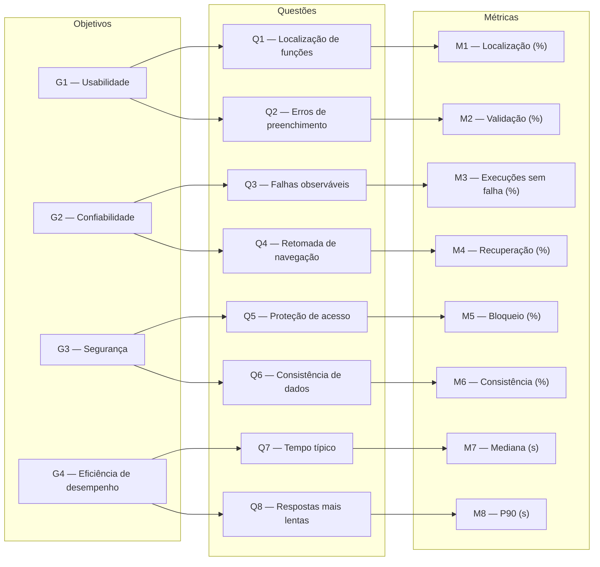

---
hide:
  - toc
---

# Gráfico GQM

O diagrama apresenta o desdobramento das quatro características selecionadas na Fase 1. Cada objetivo possui duas questões, e cada questão está ligada à métrica que será utilizada na resposta. As hipóteses correspondentes estão na página de [questões e hipóteses](questoes-hipoteses.md).

*Figura 1 — Hierarquia GQM da avaliação da Agência Virtual da Neoenergia Brasília. Fonte: elaboração própria.*

## Matriz G–Q–H–M

| Objetivo | Subcaracterística | Questão/hipótese | Métrica | Unidade |
|---|---|---|---|---|
| [G1](objetivos.md#g1) | Apreensibilidade | [Q1/H1](questoes-hipoteses.md#q1) | [M1](metricas.md#m1) | % |
| [G1](objetivos.md#g1) | Proteção contra erros | [Q2/H2](questoes-hipoteses.md#q2) | [M2](metricas.md#m2) | % |
| [G2](objetivos.md#g2) | Maturidade | [Q3/H3](questoes-hipoteses.md#q3) | [M3](metricas.md#m3) | % |
| [G2](objetivos.md#g2) | Tolerância a falhas | [Q4/H4](questoes-hipoteses.md#q4) | [M4](metricas.md#m4) | % |
| [G3](objetivos.md#g3) | Confidencialidade | [Q5/H5](questoes-hipoteses.md#q5) | [M5](metricas.md#m5) | % |
| [G3](objetivos.md#g3) | Integridade (indireta) | [Q6/H6](questoes-hipoteses.md#q6) | [M6](metricas.md#m6) | % |
| [G4](objetivos.md#g4) | Comportamento no tempo | [Q7/H7](questoes-hipoteses.md#q7) | [M7](metricas.md#m7) | s |
| [G4](objetivos.md#g4) | Comportamento no tempo | [Q8/H8](questoes-hipoteses.md#q8) | [M8](metricas.md#m8) | s |

A ligação com as funcionalidades e prioridades da Fase 1 está detalhada em [Rastreabilidade](rastreabilidade.md). Em M3, a taxa de execuções sem falhas é calculada por fluxo; M5 exige bloqueio integral de acesso a dados protegidos. As fórmulas estão em [Métricas](metricas.md) e as regras de interpretação, em [Critérios de julgamento](criterios-julgamento.md). Os indicadores de gestão [PSM/CID](gestao-psm.md) não fazem parte da hierarquia GQM, pois acompanham a execução do projeto, não a qualidade do produto.
