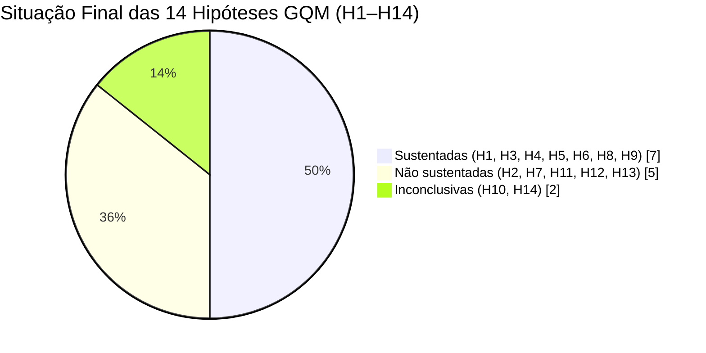

# Julgamento e conclusões

Esta página reúne o julgamento final da qualidade da **Agência Virtual da Neoenergia Brasília**, a partir dos resultados de G1 a G4 e das regras definidas nos [Critérios de julgamento](../fase2/criterios-julgamento.md) da Fase 2.

## 1. Resultado por objetivo e classificação global

Conforme os critérios da Fase 2, cada objetivo recebe o menor nível entre suas métricas elegíveis, e os objetivos são apresentados separadamente, sem cálculo de média geral.

**Tabela 1 —** Síntese dos objetivos GQM

| Objetivo | Característica (ênfase) | Métricas | Nível consolidado | Hipóteses sustentadas | Página |
|---|---|---|---|---|---|
| **G1** | Capacidade de Interação (5) | M1, M2, M9, M10 | **Insatisfatório** | H1 e H9 *(H2 não sustentada; H10 inconclusiva)* | [G1](resultados-g1-capacidade-interacao.md) |
| **G2** | Confiabilidade (4) | M3, M4, M11 | **Mínimo aceitável** | H3 e H4 *(H11 não sustentada)* | [G2](resultados-g2-confiabilidade.md) |
| **G3** | Segurança (5) | M5, M6, M12, M13 | **Insatisfatório** | H5 e H6 *(H12 e H13 não sustentadas)* | [G3](resultados-g3-seguranca.md) |
| **G4** | Eficiência de Desempenho (4) | M7, M8, M14 | **Inconclusivo** | H8 *(H7 não sustentada; H14 inconclusiva)* | [G4](resultados-g4-desempenho.md) |

_Fonte: Equipe Radia Perlman, 2026._

Aplicando a tabela de síntese da avaliação definida nos [Critérios de julgamento](../fase2/criterios-julgamento.md), condição (*"Ao menos um objetivo Insatisfatório ou ocorrência crítica"*) o veredito global para o produto no escopo observado é: **melhorias prioritárias necessárias**, acompanhado do registro explícito dos resultados inconclusivos (**M10/H10** em G1 e **M14/H14** em G4).

*Figura 1 — Distribuição consolidada das 14 hipóteses avaliadas nos objetivos G1 a G4.*

## 2. Síntese da avaliação

A avaliação empírica das 14 métricas revelou um comportamento heterogêneo entre as características da norma ISO/IEC 25010:2011 priorizadas no estudo, sem que nenhum dos quatro objetivos GQM atingisse os níveis consolidados *Alvo* ou *Excelente*:

* **Capacidade de Interação (G1 — Insatisfatório):** embora os participantes externos tenham localizado facilmente as funcionalidades básicas (**M1 = 100%, Excelente**) e reconhecido a finalidade geral das telas no limite da meta (**M9 = 80%, Alvo**), o objetivo foi rebaixado pela baixa qualidade das mensagens de erro nos formulários de login e cadastro (**M2 = 40%, Insatisfatório**), que destacam campos ou bloqueiam o avanço sem orientar a correção. Além disso, a ausência de gráfico interativo no Histórico de Consumo inviabilizou a tarefa T4, tornando **M10 inconclusiva** (ainda que 5 de 5 voluntários tenham concluído a emissão da 2ª via na tarefa T3).
* **Confiabilidade (G2 — Mínimo aceitável):** o portal apresentou excelente retomada automática após interrupções breves na conexão local (**M4 = 100%, Excelente**) e boa estabilidade nos fluxos do Histórico de Consumo (**M3 = Alvo**, com 100% na abertura e 90% na emissão de 2ª via). Contudo, as indisponibilidades observadas na tarde e na noite de 17/11/2026 reduziram a disponibilidade para **87,5%** em ambas as funções monitoradas (**M11 = Mínimo aceitável**), impedindo a sustentação de H11.
* **Segurança (G3 — Insatisfatório):** o sistema protegeu adequadamente as páginas restritas após o encerramento da sessão (**M5 = 100%, Excelente**) e manteve total consistência visual entre emissões consecutivas do relatório de Nada Consta (**M6 = 100%, Excelente**). Entretanto, o objetivo recebeu classificação **Insatisfatório** porque nenhum dos cinco relatórios emitidos pôde ter sua autenticidade confirmada no portal oficial indicado no próprio documento (**M13 = 0%, Insatisfatório**), somado à exposição de qual credencial estava incorreta no login e à ausência de registro ou notificação de acesso ao titular (**M12 = 60%, Mínimo aceitável**).
* **Eficiência de Desempenho (G4 — Inconclusivo):** nas medições auditadas em horário de pico, o percentil 90 permaneceu dentro da meta nos fluxos da Fase 2 (**M8 = Alvo**, com P90 de 4,36 s no login e 4,06 s nos indicadores), mas a mediana do login excedeu o limite de 3 segundos (**M7 = 3,425 s, Mínimo aceitável**), acompanhada de seis ocorrências sem conclusão (três falhas de solicitação e três respostas HTTP 403). Como os registros fora de pico do Bloco 3 foram invalidados na auditoria interna, não foi possível calcular a razão da **M14**, encerrando o julgamento de G4 como **Inconclusivo**.

## 3. Coerência com o propósito, uso pretendido e ODS da Fase 1

Na [Fase 1](../fase1-requisitos.md), definiu-se como propósito avaliar se a Agência Virtual da Neoenergia Brasília oferece um canal de autoatendimento acessível, confiável, seguro e ágil para o público heterogêneo do Distrito Federal, reduzindo a sobrecarga do atendimento presencial e apoiando os Objetivos de Desenvolvimento Sustentável (ODS 7, 12 e 16).

Os resultados demonstram que o portal cumpre seu uso pretendido para tarefas transacionais básicas quando está estável, como localizar e emitir a 2ª via da fatura sem exposição de dados após o logout, mas apresenta lacunas críticas que impedem a plena autonomia de cidadãos com menor familiaridade digital e comprometem a fé pública de documentos emitidos online.

**Tabela 2 —** Relação dos resultados obtidos com os ODS definidos na Fase 1

| ODS (Fase 1) | Foco avaliado | Métricas associadas | Atendimento observado |
| --- | --- | --- | --- |
| **ODS 7 — Energia Limpa e Acessível** | Disponibilidade e capacidade de interação no Login e 2ª via | M1 (100%), M2 (40%), M10 (T3: 5/5; inconcl.), M11 (87,5%) | **Parcial:** a localização e o download da 2ª via funcionam bem, mas falhas de validação no cadastro/login (M2) e indisponibilidades pontuais (M11) ainda podem obrigar o cidadão a recorrer ao atendimento presencial. |
| **ODS 12 — Consumo e Produção Responsáveis** | Apreensibilidade e desempenho do Histórico de Consumo | M1 (100%), M14 (inconclusiva; C-F2 inaplicável) | **Parcial / Limitado:** o módulo entrega apenas uma tabela estática sem gráfico comparativo, o que gerou hesitação nos voluntários (M1) e reduziu o potencial educativo sobre o consumo energético. |
| **ODS 16 — Paz, Justiça e Instituições Eficazes** | Integridade/não repúdio no Nada Consta e clareza dos Indicadores de Continuidade | M6 (100%), M9 (80%; 60% na Tela B), M13 (0%) | **Insatisfatório:** embora os dados do Nada Consta sejam consistentes (M6), a ausência de validador público no site indicado (M13) e a ambiguidade da tela de Indicadores de Continuidade (M9) comprometem a transparência institucional. |

_Fonte: Equipe Radia Perlman, 2026 (alinhado à [Rastreabilidade](../fase2/rastreabilidade.md) e ao [Alinhamento aos ODS](../fase1/alinhamento-ods.md))._
### Decisões suportadas para o requisitante

Para a gestão do produto na **Neoenergia Brasília**, os resultados sustentam três decisões imediatas quanto ao uso pretendido da plataforma:

1. **Corrigir pendências críticas de segurança e validação antes de restringir canais presenciais:** os níveis insatisfatórios em G3 (M13) e G1 (M2) afetam características de ênfase máxima (5) e devem ser priorizados no roadmap corretivo.
2. **Adotar a reformulação validada para os Indicadores de Continuidade (OM-01):** a confusão recorrente entre indicadores de continuidade e histórico de consumo (M9) foi solucionada no protótipo funcional desenvolvido pela equipe, cuja validação exploratória eliminou o erro de interpretação ([Ação de melhoria](./melhoria/acao-melhoria.md) e [Plano de validação](./melhoria/plano-validacao.md)).
3. **Executar monitoramento contínuo de disponibilidade e desempenho com telemetria interna:** as falhas HTTP 403 no login (M7) e as janelas de indisponibilidade em horário comercial/noturno (M11) exigem investigação em infraestrutura interna (fora do alcance de testes caixa-preta) e reavaliação da capacidade entre pico e fora de pico (M14).

## 4. Sugestões de melhoria concretas e priorizadas para o requisitante

A tabela a seguir traduz as conclusões da avaliação em ações concretas de Engenharia de Software, priorizadas conforme a ênfase definida na Fase 1 e a severidade das evidências coletadas:

**Tabela 3 —** Recomendações técnicas priorizadas para a Agência Virtual

| ID | Ação concreta recomendada | Módulo / Funcionalidade | Origem e evidência empírica | Prioridade | Status no projeto |
| --- | --- | --- | --- | --- | --- |
| **AM-01** | **Implementar validador público de autenticidade do Nada Consta** no endereço indicado no PDF (consulta por código de autenticação + conta contrato) e/ou assinar digitalmente o PDF com certificado verificável (ICP-Brasil). | Módulo de Faturamento (`Relatório de Nada Consta`) | **G3 / M13 (0% — Insatisfatório):** 5 de 5 documentos indicam URL sem ferramenta de validação ativa. | **Crítica** | Recomendada ao requisitante |
| **AM-02** | **Revisar o componente de validação de formulários** para exibir mensagens textuais específicas e inline junto a cada campo inválido, diferenciando campo obrigatório vazio de formato incorreto e padronizando o comportamento entre Cadastro e Login. | Módulo de Autenticação (`Login e Cadastro`) | **G1 / M2 (40% — Insatisfatório):** 6 de 10 entradas inválidas exibiram apenas borda vermelha sem texto ou mensagem genérica de segurança. | **Crítica** | Recomendada ao requisitante |
| **AM-03** | **Reformular a tela de Indicadores de Continuidade** em página única com subtítulo explicativo em linguagem simples (sem o termo "histórico"), gráfico dinâmico por período, cartões mensais com limites visíveis e exportação em CSV/PDF (OM-01). | Módulo de Monitoramento (`Indicadores de Continuidade`) | **G1 / M9 (80%; 60% na Tela B):** 2 de 5 voluntários confundiram a tela com Histórico de Consumo e outros 2 hesitaram. | **Alta** | **Protótipo implementado e validado** ([Ação de melhoria](./melhoria/acao-melhoria.md)) |
| **AM-04** | **Corrigir a mensagem de falha de autenticação e adicionar trilha de acesso ao titular:** substituir *"Usuário com CPF/CNPJ informado não foi encontrado"* por mensagem neutra (*"CPF/CNPJ ou senha inválidos"*), exibir data/hora do último acesso (ou alerta por e-mail) e revisar o tempo de expiração de sessão por inatividade. | Módulo de Autenticação (`Login e Sessão`) | **G3 / M12 (60% — Mínimo aceitável):** itens A2 e R1 não atendidos; item A3 inconclusivo (sessão mantida aberta na 2ª rodada). | **Alta** | Recomendada ao requisitante |
| **AM-05** | **Investigar e corrigir causas de erros HTTP 403 e quedas intermitentes no gateway de autenticação**, reduzindo a mediana do tempo de resposta do login para ≤ 3 s e elevando a disponibilidade da 2ª via e do Nada Consta para ≥ 95%. | Autenticação e Serviços Transacionais (`Login`, `2ª Via`, `Nada Consta`) | **G2 / M11 (87,5%) e G4 / M7 (3,425 s):** 4 indisponibilidades em 17/11 e 6 requisições sem conclusão (incluindo 3 erros HTTP 403) no login em 19/11. | **Alta** | Recomendada ao requisitante |
| **AM-06** | **Adicionar rótulos textuais explícitos aos botões de ação críticos** na tela inicial e na emissão de faturas (ex.: rotular o ícone de impressora como *"Baixar PDF"* — OM-02 e OM-03). | Tela Inicial e `Emissão de 2ª Via` | **G1 / M1 e M10:** P02 levou 190 s na T3 para identificar o ícone sem texto; P03 e P04 relataram tela inicial pouco intuitiva. | **Média** | Recomendada ao requisitante |
| **AM-07** | **Implementar gráfico interativo com filtro de período e título claro no Histórico de Consumo** (OM-04), permitindo comparação visual de consumo em kWh ao longo dos meses. | Módulo de Monitoramento (`Histórico de Consumo`) | **G1 / M1, M10 e G4 / M14:** tela atual contém apenas tabela estática, impedindo T4 e C-F2 e gerando dúvida em P04. | **Média** | Recomendada ao requisitante |
| **AM-08** | **Otimizar o tempo de geração do PDF da 2ª via** (cache de documentos já fechados ou geração assíncrona) e executar nova bateria auditada comparando pico e fora de pico para fechar a linha de base de capacidade. | Módulo de Faturamento (`Emissão de 2ª Via`) | **G4 / M7, M8 e M14:** fluxo complementar do PDF apresentou mediana de 4,140 s (4,015 s na M14) e P90 de 5,38 s no pico. | **Média** | Recomendada ao requisitante |

*Fonte: Equipe Radia Perlman, 2026.*

## 5. Limitações da avaliação

* **Amostras pequenas e por conveniência:** os resultados descrevem as condições, os dispositivos e os participantes observados durante a janela de execução (16/11 a 20/11/2026), não permitindo generalização estatística para toda a base de consumidores do Distrito Federal.
* **Ausência de gráfico interativo no Histórico de Consumo:** a interface real do portal apresenta apenas uma tabela estática de leituras e valores, sem gráfico ou seletor de período. Essa característica inviabilizou a execução da tarefa T4 (reduzindo a amostra elegível de M10 para 5 tarefas e tornando M10/H10 inconclusivas) e impediu a coleta do fluxo C-F2 na métrica M14.
* **Descarte dos registros fora de pico (Bloco 3):** os dados submetidos para a janela fora de pico foram invalidados na auditoria interna da equipe por inconsistência e ausência de rastreabilidade (ver [Obtenção das medidas](./obtencao-medidas.md)), restringindo a análise de desempenho à janela de pico e tornando M14 e G4 definitivamente inconclusivos.
* **Estado dos dados na unidade consumidora de teste de desempenho:** durante a medição de M7 e M8 no fluxo de Indicadores de Continuidade, a unidade consumidora utilizada apresentou a mensagem *"Unidade sem histórico de indicadores de continuidade"*; logo, os tempos registrados refletem a resposta dessa tela vazia, e não o carregamento de séries históricas populadas.
* **Abordagem estritamente de caixa-preta:** sem acesso ao código-fonte, aos logs internos ou à infraestrutura da concessionária, as conclusões limitam-se ao comportamento observável pela interface web em contas autorizadas.

## Histórico de Versões

| Versão | Data | Descrição da Alteração | Autor(a) |
| --- | --- | --- | --- |
| 1.0 | 21/11/2026 | Criação da estrutura da página com os resultados parciais de G1 | Beatriz |
| 1.1 | 22/11/2026 | Atualiza G1 e G3 | Isabella |
| 1.2 | 23/11/2026 | Inclusão do julgamento final de G2 (Mínimo aceitável), ajuste de H10 em G1 e registro da limitação do Histórico de Consumo | Dara Maria Barbosa de Sousa |
| 1.3 | 24/11/2026 | Consolidação final de G4 (Inconclusivo),  Classificação global pela regra da Fase 2,  Gráfico das hipóteses,  Alinhamento com propósito/ODS e decisões para o requisitante,  Plano de recomendações priorizadas (G1–G4) e limitações completas (critérios F4-C4 e F4-C5) | Dara Maria Barbosa de Sousa |
| 1.4 | 24/11/2026 | Correção de links | Henrique Martins Alencar |
