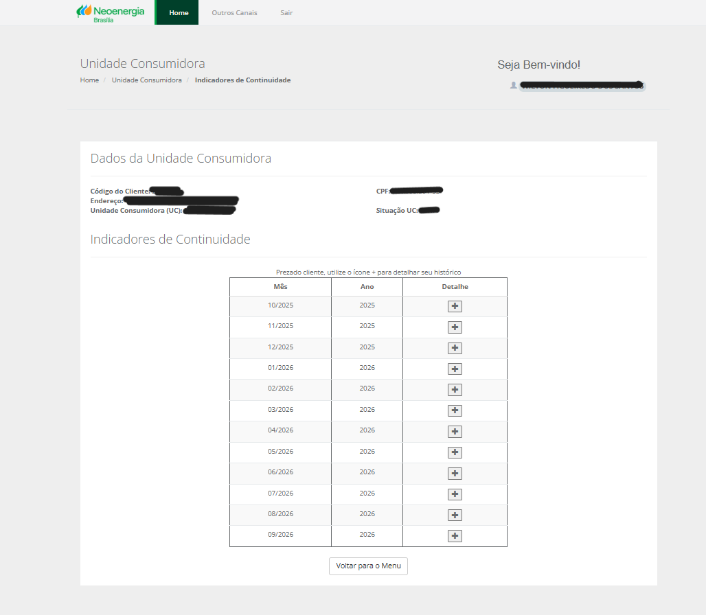
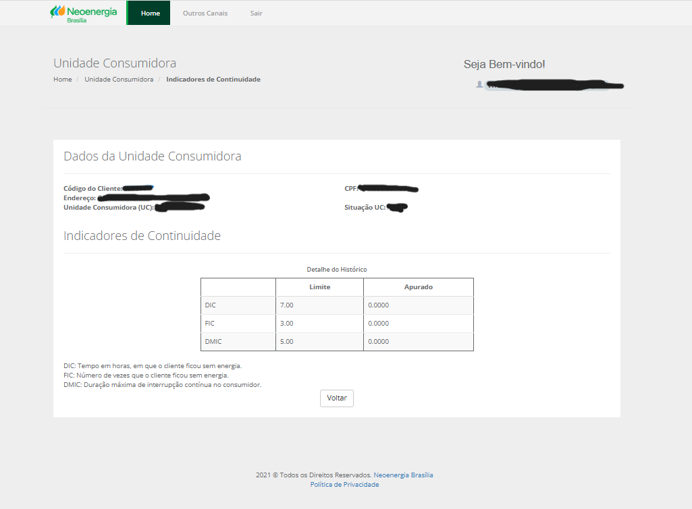
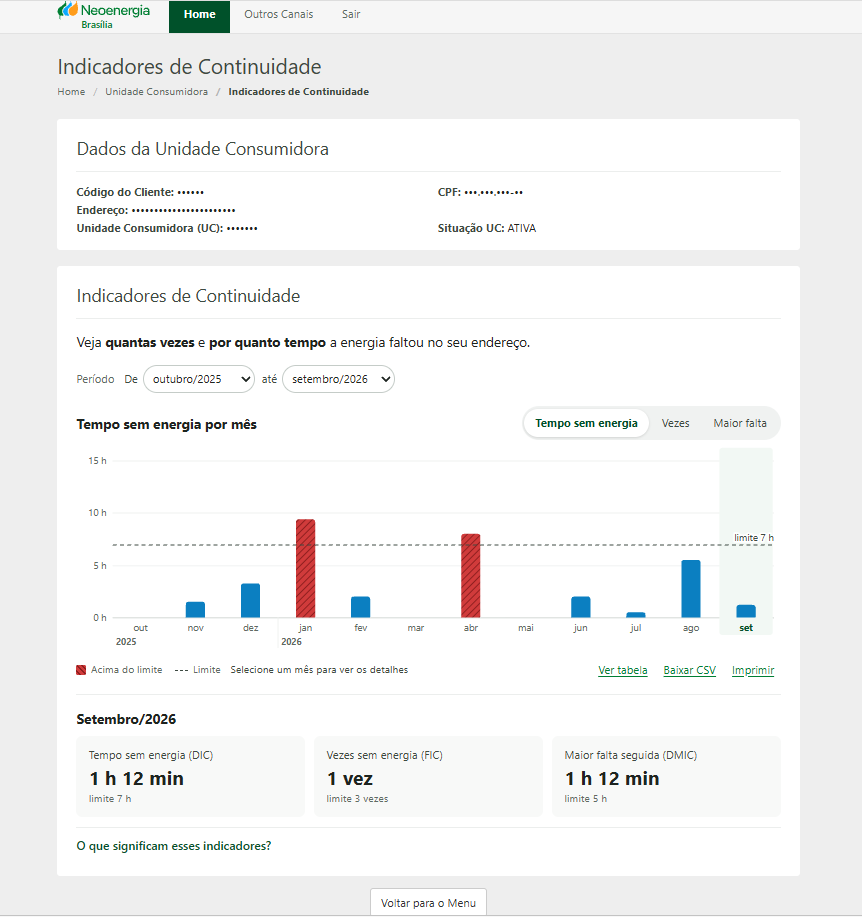
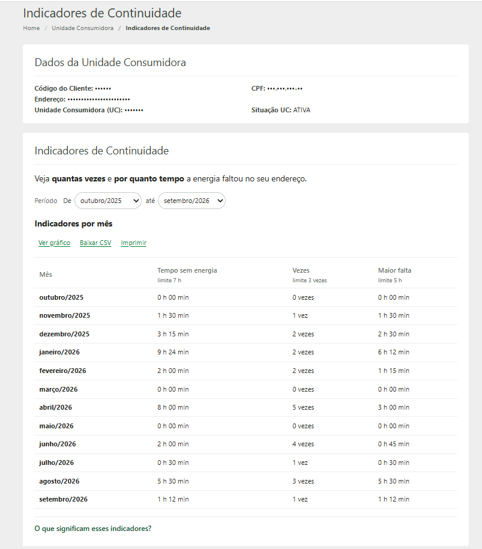

# Justificativa
 
> **Projeto:** Avaliação de Qualidade de Software — Agência Virtual Neoenergia Brasília  
> **Origem:** [Resultados de G1 — Capacidade de Interação](../resultados-g1-capacidade-interacao.md), oportunidade **OM-01**  
> **Funcionalidade-alvo:** Indicadores de Continuidade (DIC, FIC e DMIC)    
> **Tipo de ação escolhida:** Protótipo funcional
> **Protótipo:** [abrir o protótipo navegável](../prototipo/index.html)
 
## 1. Origem da ação
 
Esta página desenvolve a oportunidade **OM-01**, priorizada na seção [Oportunidades de melhoria](../resultados-g1-capacidade-interacao.md#5-oportunidades-de-melhoria) dos Resultados de G1.

## 2. Justificativa da escolha
 
O problema é de **interface, linguagem e fluxo de navegação**, e não técnico: não houve falha do sistema em nenhuma sessão. Por isso a ação escolhida é um **protótipo funcional**, pelos seguintes motivos:
 
1. **Ponto mais frágil da avaliação:** com mais um erro na Tela B, M9 cairia para 70% e H9 não seria sustentada.
2. **Erro induzido pela tela:** a confusão sempre com o histórico de consumo indica que o layout (tabela de Mês/Ano) e o texto ("detalhar seu histórico") levam a essa leitura. Isso se corrige no desenho da tela.
3. **Validação antes do código:** o protótipo permite repetir o cenário U-03 com o mesmo protocolo, sem depender de acesso ao código da Neoenergia.
 
## 3. Ponto de partida

Hoje a funcionalidade tem duas telas, e o usuário precisa ir e voltar a cada mês consultado.

| Tela 1 — Lista de meses | Tela 2 — Detalhe do mês |
|---|---|
|  |  |

## 4. O que será criado
 
### 4.1 Conceito
 
Centralizar as duas telas em **uma única página**, que responda em poucos segundos as três perguntas do usuário:
 
1. **Para que serve esta página?** Texto explicativo em linguagem simples.
2. **Está tudo bem com a minha energia?** Cartões do mês selecionado com o valor e o limite de cada indicador.
3. **Quando e quanto fiquei sem energia?** Gráfico dinâmico por mês, com o limite permitido e o detalhe na mesma tela.

### 4.2 Problemas atuais

| # | Problema da tela atual | O que será criado |
|---|---|---|
| P1 | Título "Indicadores de Continuidade" é jargão, sem subtítulo | Título original mantido, com subtítulo em linguagem simples que diz para que a página serve |
| P2 | Texto de apoio fala em "histórico", reforçando a confusão com o consumo | Texto "detalhar seu histórico" substituído por um subtítulo que fala de faltas de energia; a palavra "histórico" não aparece na página |
| P3 | Lista sem dados: só Mês, Ano e botão "+" | Gráfico e mês selecionado visíveis ao abrir a página |
| P4 | Colunas Mês e Ano redundantes | Eixo do gráfico com o mês abreviado e o ano agrupado|
| P5 | Comparar meses exige até 12 idas e voltas | Todos os meses no gráfico; detalhe na mesma página |
| P6 | Sem destaque para meses acima do limite | Coluna vermelha com hachura no gráfico |
| P7 | A tela de detalhe não informa o mês | Nome do mês selecionado como título dos cartões e período escolhido sempre visível nos campos "De" e "até"  |
| P8 | Siglas como rótulo principal; explicação no rodapé | Nome do dia a dia como rótulo, sigla entre parênteses e uma seção de ajuda expansível |
| P9 | Números fora do padrão pt-BR ("7.00", "0.0000") | Horas em "h min", contagens em "vezes", vírgula decimal |
| P10 | Limite e Apurado sem interpretação | Valor e limite lado a lado, com card destacado quando acima do limite, e linha do limite no gráfico|
| P11 | Ausência de opções para exportar, imprimir ou salvar os dados apresentados | Ações de exportação em CSV e de impressão/salvamento em PDF, identificadas por texto |

### 4.3 Requisitos funcionais

| ID | Requisito | Resolve |
|---|---|---|
| RF-01 | Exibir em uma única página o título, o gráfico e os indicadores do mês selecionado, sem repetir informação | P3, P5 |
| RF-02 | Manter o título "Indicadores de Continuidade" e acrescentar subtítulo em linguagem simples sobre faltas de energia, sem a palavra "histórico" | P1, P2 |
| RF-03 | Mostrar, para o mês selecionado, o valor e o limite de cada indicador, destacando o valor acima do limite | P9, P10 |
| RF-04 | Permitir escolher o indicador exibido no gráfico | P5, P8 |
| RF-05 | Permitir escolher o período por mês inicial ("De") e final ("até") | P5 |
| RF-06 | Destacar meses acima do limite com cor e padrão visual | P6 |
| RF-07 | Atualizar cartões ao selecionar um mês, sem trocar de página, sempre informando o mês; ocultá-los na visualização em tabela | P7 |
| RF-08 | Oferecer visualização em tabela equivalente ao gráfico | P5 |
| RF-09 | Exportar os dados em CSV e imprimir/salvar em PDF, com ações identificadas por texto | P11  |
| RF-10 | Reunir em uma seção de ajuda a explicação das siglas e da compensação | P8 |

### 4.4 Requisitos não funcionais

| ID | Requisito | Critério verificável |
|---|---|---|
| RNF-01 | Acessibilidade | Conformidade com WCAG 2.2 nível AA (verificação com axe/Lighthouse e inspeção manual) |
| RNF-02 | Responsividade | Funcional em 320 px, 768 px e 1280 px de largura |
| RNF-03 | Formatação pt-BR | Vírgula decimal, horas em "h min", meses em português |
| RNF-04 | Independência de cor | Nenhuma informação transmitida apenas por cor |
| RNF-05 | Consistência visual | Cores e tipografia da identidade atual da Agência Virtual |

## 5. Protótipo Funcional
Nessa seção são apresentadas imagens da primeira versão do protótipo funcional, proposto como ação de melhoria.

| Formato gráfico| Formato tabela |
|---|---|
|  |  |

## 6. Referências

- Equipe do projeto. [Resultados de G1 — Capacidade de Interação](../resultados-g1-capacidade-interacao.md).
- ANEEL. *PRODIST — Módulo 8: Qualidade do Fornecimento de Energia Elétrica.* Disponível em: <https://www.gov.br/aneel/pt-br/centrais-de-conteudos/procedimentos-regulatorios/prodist>
- NIELSEN, J. *10 Usability Heuristics for User Interface Design.* Nielsen Norman Group.
- W3C. *Web Content Accessibility Guidelines (WCAG) 2.2.*
- ISO 9241-11:2018. *Ergonomics of human-system interaction — Usability: Definitions and concepts.*

## Histórico de Versões

| Versão | Data | Descrição da Alteração | Autor(a) |
|---|---|---|---|
| 1.0 | 21/11/2026 | Criação da página | Beatriz |
| 1.1 | 22/11/2026 | Proposta inicial da ação de melhoria para a funcionalidade Indicadores de Continuidade | Beatriz |
| 1.2 | 22/11/2026 | Implementação do protótipo | Beatriz |
| 1.3 | 23/11/2026 | Atualização da página com os problemas da tela atual, os requisitos do protótipo, o link para o protótipo e as imagens da tela anterior | Beatriz |
| 1.4 | 23/11/2026 | Adiciona imagens da primeira versão do protótipo | Beatriz |
| 1.5 | 23/11/2026 | Implementação de mudanças no protótipo com base nos dados coletados| Beatriz |