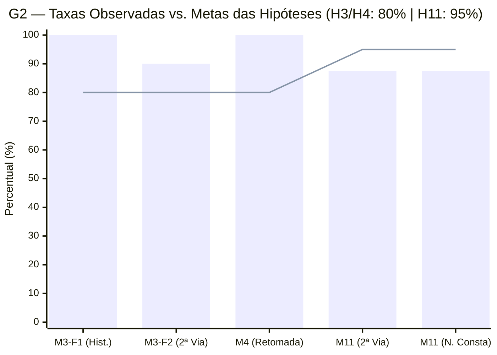

# Resultados de G2 — Confiabilidade

Esta página apresenta os resultados do objetivo G2, que avalia a maturidade do histórico de consumo, a disponibilidade da 2ª via e do Nada Consta e a retomada da navegação após interrupção local da conexão.

As fórmulas, as faixas de pontuação e as quantidades mínimas são as definidas em [Métricas](../fase2/metricas.md) e nos [Critérios de julgamento](../fase2/criterios-julgamento.md). Os dados brutos estão relacionados em [Dados brutos e evidências](dados-brutos.md).

## M3 — Execuções sem falhas observáveis

**Questão Q3:** Com que frequência os fluxos são concluídos sem falhas visíveis?

**Hipótese H3:** cada fluxo do histórico de consumo apresentará ao menos 80% de execuções sem falha observável.

**Fórmula:** `M3(f) = 100 × E(f) / N(f)`, em que **f** identifica o fluxo; **E(f)** = execuções sem falha nesse fluxo; **N(f)** = execuções elegíveis do mesmo fluxo.

As medições da M3, vinculadas ao cenário R-01, foram realizadas em 19/11/2026. Foram observados dois fluxos vinculados ao Histórico de Consumo: abertura da página e emissão de segunda via a partir da tabela de faturas. Cada fluxo teve dez execuções elegíveis, distribuídas entre manhã e tarde.

**Tabela 1 — Resultados por fluxo**

| Fluxo | Manhã | Tarde | Sem falha (E) | Elegíveis (N) | M3 = 100 × E/N | Classificação |
|---|---:|---:|---:|---:|---:|---|
| F1 — Abertura do Histórico de Consumo | 5 | 5 | 10 | 10 | 100% | Excelente |
| F2 — Emissão de segunda via pelo histórico | 5 | 5 | 9 | 10 | 90% | Alvo |

_Fonte: [M3-resultados.csv](../dados-coleta/M3/M3-resultados.csv), Equipe Radia Perlman, 2026._

A abertura do histórico apresentou a tabela de faturas nas dez execuções, sem falhas observáveis. Na emissão de segunda via, uma das dez tentativas não foi concluída: às 08:46, a interface exibiu a mensagem “Nosso sistema está indisponível no momento”. A ocorrência foi mantida entre os casos elegíveis. As demais nove emissões foram concluídas.

O cálculo foi realizado por fluxo, sem reunir as duas funcionalidades em um percentual geral:

- **F1:** `M3(F1) = 100 × 10 / 10 = 100%`.
- **F2:** `M3(F2) = 100 × 9 / 10 = 90%`.

**Classificação:** **Alvo** (menor nível entre os fluxos avaliados).

**Resultado da hipótese:** **H3 sustentada** (ambos os fluxos atingiram ao menos 80% com amostra mínima de dez execuções cada).

**Resposta a Q3:** com alta frequência nas condições observadas — 100% das execuções na abertura do Histórico de Consumo (10/10) e 90% na emissão de segunda via pelo histórico (9/10, com uma indisponibilidade pontual às 08:46), sustentando H3.

### Ambiente e evidências

A coleta foi realizada em um Dell Inspiron 15 3511 (Intel Core i5-1135G7, 8 GB de RAM), Fedora Linux 44 (Sway Spin), Mozilla Firefox e conexão Wi-Fi de 5 GHz, sem VPN. Os horários e as condições de cada execução constam do arquivo de dados brutos.

Os registros visuais incluem a abertura do histórico e a emissão da segunda via em ambos os períodos, além da [mensagem de indisponibilidade às 08:46](../evidencias/M3/segundaVia-19112026-erro-01-arthur.jpeg). As capturas representativas estão relacionadas na [documentação de coleta da M3](../dados-coleta/M3/M3-resultados.md).

## M4 — Retomada após interrupção local da conexão

**Questão Q4:** É possível continuar a navegação após uma perda breve de conexão?

**Hipótese H4:** ao menos 80% das interrupções locais permitirão retomar o fluxo e restabelecer o estado anterior.

**Fórmula:** `M4 = 100 × R / N`, em que **R** = tentativas em que a navegação foi retomada conforme o critério; **N** = interrupções locais elegíveis.

As medições da M4, vinculadas ao cenário R-02, foram realizadas em 20/11/2026, entre 19h29 e 19h36. Foram executadas cinco tentativas independentes de interrupção local da conexão (por 5 segundos) durante a consulta de leitura do relatório de Nada Consta, sem envio de formulários ou alteração de dados cadastrais.

**Tabela 2 — Resultados das tentativas de retomada**

| Tentativa | Horário | Desconexão local | Ação manual | Tempo de retomada | Resultado observado | Classificação |
|---|---:|---:|---:|---:|---|---|
| `M4-R02-20112026-01` | 19:29 | 5 s | Nenhuma | 18 s | Retomada automática dentro de 30 s | Sucesso |
| `M4-R02-20112026-02` | 19:31 | 5 s | Nenhuma | 20 s | Retomada automática dentro de 30 s | Sucesso |
| `M4-R02-20112026-03` | 19:33 | 5 s | Nenhuma | 19 s | Retomada automática dentro de 30 s | Sucesso |
| `M4-R02-20112026-04` | 19:35 | 5 s | Nenhuma | 23 s | Retomada automática dentro de 30 s | Sucesso |
| `M4-R02-20112026-05` | 19:36 | 5 s | Nenhuma | 22 s | Retomada automática dentro de 30 s | Sucesso |

_Fonte: [M4-registros.csv](../dados-coleta/M4/M4-registros.csv), Equipe Radia Perlman, 2026._

Nas cinco tentativas, ao desativar a interface de rede local por 5 segundos, o navegador sinalizou momentaneamente a perda de conexão, mas retomou automaticamente o carregamento após o restabelecimento da rede, concluindo a consulta sem encerrar a sessão autenticada nem reiniciar a jornada do usuário. Os tempos totais de retomada variaram entre 18 s e 23 s (média de 20,4 s e mediana de 20,0 s), todos abaixo do limite máximo de 30 segundos estipulado no protocolo.

**Cálculo:** `M4 = 100 × 5 / 5 = 100%`.

**Classificação:** **Excelente** (95% ou mais).

**Resultado da hipótese:** **H4 sustentada** (M4 ≥ 80%, com amostra mínima de cinco tentativas).

**Resposta a Q4:** sim. Em todas as cinco interrupções locais de rede (100%), o portal retomou automaticamente a consulta em até 23 segundos sem encerrar a sessão nem reiniciar a jornada do usuário.

### Ambiente e evidências

A coleta foi realizada em um computador pessoal (desktop), sistema operacional Windows 11, navegador Microsoft Edge (versão `157.0.4341.60`, com cache padrão habilitado) e conexão cabeada (Ethernet), utilizando conta própria autorizada. Os horários e metadados completos de cada execução constam do arquivo de dados brutos.

Os registros visuais incluem as capturas anonimizadas da conclusão de cada uma das cinco tentativas ([execução 01](../evidencias/M4/M4-R02-20112026-01.png), [execução 02](../evidencias/M4/M4-R02-20112026-02.png), [execução 03](../evidencias/M4/M4-R02-20112026-03.png), [execução 04](../evidencias/M4/M4-R02-20112026-04.png) e [execução 05](../evidencias/M4/M4-R02-20112026-05.png)). O detalhamento completo da análise e das limitações está disponível na [documentação de coleta da M4](../dados-coleta/M4/M4-resultados.md).

O resultado da M4 reflete a recuperabilidade observada no ambiente cliente (interação entre o navegador de referência e a aplicação web) em consulta de leitura, não avaliando isoladamente mecanismos de tolerância a falhas nos servidores.

## M11 — Disponibilidade nas verificações agendadas

**Questão Q11:** A 2ª via e o Nada Consta estão acessíveis quando o usuário precisa deles?

**Hipótese H11:** a 2ª via e o Nada Consta estarão operacionais em ao menos 95% das verificações agendadas, cada um.

**Fórmula:** `M11(f) = 100 × D(f) / N(f)`, em que **f** identifica a função; **D(f)** = verificações com a função operacional em até 30 segundos; **N(f)** = verificações elegíveis da função.

As medições da M11, vinculadas ao cenário R-03, foram realizadas em revezamento pela equipe entre **17/11/2026 e 20/11/2026**, com quatro verificações diárias (manhã, almoço, tarde e noite) para as funcionalidades **2ª Via** e **Nada Consta**, totalizando **16 verificações elegíveis por função** (32 registros no total), conforme definido nas Fases 2 e 3.

**Tabela 3 — Resultados de disponibilidade por dia e função**

| Data | Avaliador(a) | 2ª Via (Sucesso / Total) | Nada Consta (Sucesso / Total) | Ocorrências observadas |
|---|---|---:|---:|---|
| 17/11/2026 | Dara Maria Barbosa de Sousa | 2 / 4 | 2 / 4 | Indisponibilidade na tarde (16:00, erro e carregamento por ~2 min) e na noite (21:00, erro no login) |
| 18/11/2026 | Isabella Mendes Choukaira | 4 / 4 | 4 / 4 | Sem falhas observáveis |
| 19/11/2026 | Arthur de Lima Sobreira | 4 / 4 | 4 / 4 | Sem falhas (mensagem de ausência de fatura aberta na 2ª via, esperada para a conta) |
| 20/11/2026 | Henrique Martins Alencar | 4 / 4 | 4 / 4 | Sem falhas observáveis |
| **Total** | **Equipe Radia Perlman** | **14 / 16** | **14 / 16** | **4 indisponibilidades (2 por função) no dia 17/11** |

_Fonte: [M11-registros.csv](../dados-coleta/M11/M11-registros.csv), Equipe Radia Perlman, 2026._

**Tabela 4 — Consolidação da M11 por função**

| Função | Operacional em ≤ 30 s (D) | Elegíveis (N) | M11 = 100 × D/N | Classificação |
|---|---:|---:|---:|---|
| 2ª Via | 14 | 16 | **87,5%** | Mínimo aceitável |
| Nada Consta | 14 | 16 | **87,5%** | Mínimo aceitável |

O cálculo foi realizado separadamente por função:

- **2ª Via:** `M11(2ª via) = 100 × 14 / 16 = 87,5%`.
- **Nada Consta:** `M11(Nada Consta) = 100 × 14 / 16 = 87,5%`.

**Classificação:** **Mínimo aceitável** (de 80% a menos de 95% na escala específica da M11).

**Resultado da hipótese:** **H11 não sustentada** (ambas as funções ficaram abaixo da meta de 95%).

**Resposta a Q11:** parcialmente. As duas funções permaneceram acessíveis em 87,5% das verificações agendadas (14/16 em cada), porém apresentaram indisponibilidades na tarde e na noite de 17/11/2026 que impediram o alcance da meta de 95%.

### Análise e evidências

- As indisponibilidades concentraram-se em **17/11/2026**: às 16h00, o portal exibiu alerta de erro com carregamento contínuo superior a 2 minutos; às 21h00, a plataforma impediu a autenticação com mensagem de erro, inviabilizando o acesso às duas funcionalidades.
- Nos dias 18/11, 19/11 e 20/11, ambas as funcionalidades responderam dentro do limite de 30 segundos em todos os turnos avaliados.
- Os registros completos constam no [CSV da M11](../dados-coleta/M11/M11-registros.csv), com capturas anonimizadas armazenadas em `docs/evidencias/M11/`, incluindo os registros de erro de 17/11 ([erro 16h00](../evidencias/M11/tela_erro-1711-03-dara.png), [indisponibilidade 16h00](../evidencias/M11/indisponivel-1711-03-dara.png) e [erro login 21h00](../evidencias/M11/tela_erro-1711-04-dara.png)).

## Síntese do objetivo G2

**Tabela 5 — Consolidação das métricas e hipóteses de G2**

| Métrica | Resultado | Classificação | Hipótese |
|---|---|---|---|
| M3 — Execuções sem falhas observáveis | F1: 100% (10/10) · F2: 90% (9/10) | Alvo | H3 sustentada |
| M4 — Retomada após interrupção local | 100% (5/5) | Excelente | H4 sustentada |
| M11 — Disponibilidade nas verificações agendadas | 2ª Via: 87,5% (14/16) · Nada Consta: 87,5% (14/16) | Mínimo aceitável | H11 não sustentada |

*Figura 1 — Comparação entre os resultados obtidos nas métricas de Confiabilidade (G2) e os respectivos patamares mínimos exigidos pelas hipóteses (linha de meta).*

Conforme a regra de consolidação da Fase 2 (menor nível entre as métricas do objetivo), o objetivo **G2 — Confiabilidade** recebe classificação **Mínimo aceitável**, com **H3 e H4 sustentadas** e **H11 não sustentada**.

## Histórico de Versões

| Versão | Data | Descrição da Alteração | Autor(a) |
| --- | --- | --- | --- |
| 1.0 | 21/11/2026 | Criação da estrutura da página | Beatriz |
| 1.1 | 22/11/2026 | Inclusão dos cálculos e resultados da M3 | Arthur de Lima Sobreira |
| 1.2 | 22/11/2026 | Inclusão de cálculos e resultados da M4 | Henrique |
| 1.3 | 23/11/2026 | Inclusão dos cálculos e resultados da M11 e síntese final de G2 | Dara Maria Barbosa de Sousa |
| 1.4 | 24/11/2026 | Explicitação das questões e hipóteses GQM (Q3, Q4 e Q11), respostas diretas às questões e gráfico comparativo (critério F4-C3) | Dara Maria Barbosa de Sousa |
