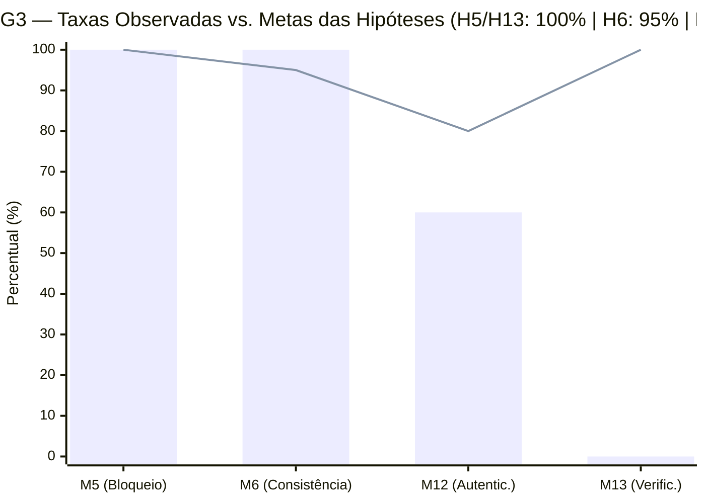

# Resultados de G3 — Segurança

Esta página apresenta os resultados do objetivo G3, que avalia a autenticação no login e no cadastro, a proteção das páginas restritas após o logout e a consistência e a autenticidade do relatório de Nada Consta.

As fórmulas, as faixas de pontuação e as quantidades mínimas são as definidas em [Métricas](../fase2/metricas.md) e nos [Critérios de julgamento](../fase2/criterios-julgamento.md). Os dados brutos estão relacionados em [Dados brutos e evidências](dados-brutos.md).

## M5 — Bloqueio de acesso a páginas restritas

**Questão Q5:** Páginas restritas permanecem protegidas depois do logout?

**Hipótese H5:** 100% das verificações sem sessão ativa impedirão o acesso utilizável a dados protegidos.

**Fórmula:** `M5 = 100 × B / N`, em que **B** = verificações sem acesso utilizável a informação protegida; **N** = verificações elegíveis realizadas sem sessão ativa.

A coleta foi realizada por Isabella em 16/11/2026, às 21h, no cenário S-01. Foi utilizada uma conta própria em computador pessoal com Windows 11, Microsoft Edge e conexão Wi-Fi. Após o logout, foram executadas ações de retorno à página anterior, atualização e reabertura dos endereços de duas páginas restritas.

**Tabela 1 — Verificações da M5**

| ID | Página restrita | Ação após logout | Resultado observado | Adequada? |
|---|---|---|---|---:|
| M5-S01-20261116-01 | Segunda via | Botão voltar do navegador | Permaneceu na página de login, sem permitir retornar à conta | 1 |
| M5-S01-20261116-02 | Segunda via | Atualizar página | Permaneceu na tela de login, sem recuperar o acesso à área restrita | 1 |
| M5-S01-20261116-03 | Segunda via | Abrir novamente o endereço da segunda via | Permaneceu na página de login, sem permitir retornar à conta | 1 |
| M5-S01-20261116-04 | Histórico de consumo | Botão voltar do navegador | Permaneceu na página de login, sem retornar à área restrita | 1 |
| M5-S01-20261116-05 | Histórico de consumo | Reabrir o endereço | Permaneceu na página de login, sem permitir acesso ao conteúdo protegido | 1 |
| **Total** | **Duas páginas** | **Cinco verificações** | **Nenhuma exposição utilizável observada** | **5/5** |

A quantidade mínima definida para a métrica é de cinco verificações, preferencialmente distribuídas por pelo menos duas páginas restritas. A coleta atingiu esse mínimo.

**Cálculo:** `M5 = 100 × 5 / 5 = 100%`.

**Classificação:** **Excelente** (100% de bloqueios corretos).

**Resultado da hipótese:** **H5 sustentada**, pois todas as verificações impediram o acesso utilizável a dados protegidos sem sessão ativa.

**Análise:**

- Nas cinco verificações, o sistema permaneceu na página de login e não permitiu retornar à área restrita.
- Foram avaliadas as páginas de segunda via e histórico de consumo, com ações distintas do navegador.
- O resultado representa o comportamento observável nas páginas e condições testadas; não comprova a implementação interna do controle de sessão.
- **Resposta a Q5:** sim, nas condições avaliadas. As cinco verificações impediram o retorno utilizável às páginas restritas após o logout.

**Recomendações:** preservar a exigência de autenticação em acessos diretos, manter o bloqueio após ações de voltar e atualizar e repetir periodicamente as verificações em outras funcionalidades protegidas. Em futuras coletas, distinguir também conteúdo antigo mantido em cache de acesso efetivo aos dados.

**Evidências:** [CSV de registros](../dados-coleta/M5/M5-registros.csv) e [ficha consolidada](../evidencias/M5/M5-S01-16112026-01.png).

**Limitações:** o resultado se restringe às duas páginas testadas, à conta própria e ao ambiente registrado. A coleta não constitui auditoria de segurança, teste de invasão ou verificação de todos os endpoints da aplicação.

## M6 — Consistência de informações estáveis

**Questão Q6:** Informações estáveis permanecem iguais em consultas consecutivas?

**Hipótese H6:** ao menos 95% das comparações de campos estáveis do Nada Consta serão consistentes.

**Fórmula:** `M6 = 100 × C / N`, em que **C** = comparações consistentes; **N** = comparações elegíveis da mesma referência.

As medições da M6, vinculadas ao cenário S-02, foram realizadas em 17/11/2026, entre 17h12 e 17h15. Foram emitidas cinco vias consecutivas da Declaração de Quitação Anual de Débitos (Nada Consta) na mesma sessão autenticada, sem alterações cadastrais no intervalo. Sete campos estáveis (`C01` a `C07`) das Emissões 2, 3, 4 e 5 foram comparados com a Emissão 1 de referência, totalizando 28 comparações elegíveis, além de três campos dinâmicos (`D01` a `D03`) excluídos por variarem a cada documento gerado.

**Tabela 2 — Resultados por campo observado no Nada Consta**

| Código | Campo observado | Natureza | Consistentes (C) | Elegíveis (N) | M6 = 100 × C/N | Interpretação |
|---|---|---|---:|---:|---:|---|
| `C01` | Nome do consumidor atual | Estável | 4 | 4 | 100% | Consistente |
| `C02` | CPF/CNPJ do consumidor | Estável | 4 | 4 | 100% | Consistente |
| `C03` | Endereço da unidade consumidora/expediente | Estável | 4 | 4 | 100% | Consistente |
| `C04` | Município e Estado (`BRASILIA` / `DF`) | Estável | 4 | 4 | 100% | Consistente |
| `C05` | Conta Contrato | Estável | 4 | 4 | 100% | Consistente |
| `C06` | Período de quitação (`01/01/2025 a 31/12/2025`) | Estável | 4 | 4 | 100% | Consistente |
| `C07` | Declaração de inexistência de débitos (`2025 e anos anteriores`) | Estável | 4 | 4 | 100% | Consistente |
| `D01`–`D03` | Data/hora de emissão, nº do pedido e código de autenticação | Dinâmico | — | — | — | Excluídos (12 registros) |

_Fonte: [M6-registros.csv](../dados-coleta/M6/M6-registros.csv), Equipe Radia Perlman, 2026._

Todos os sete campos cadastrais e declaratórios estáveis mantiveram valores idênticos entre a emissão de referência e as quatro emissões subsequentes, sem perda de formatação ou divergência de conteúdo. Os campos transacionais dinâmicos (`D01` a `D03`) foram registrados como não comparáveis e excluídos do denominador com justificativa.

O cálculo da métrica considerou todas as 28 comparações elegíveis:

- **M6:** `M6 = 100 × C / N = 100 × 28 / 28 = 100%`.

**Classificação:** **Excelente** (`100%` na escala específica da métrica).

**Resultado da hipótese:** **H6 sustentada** (M6 ≥ 95%, com amostra superior ao mínimo de 20 comparações válidas).

**Resposta a Q6:** sim. Todos os sete campos estáveis comparados nas cinco emissões consecutivas do relatório de Nada Consta permaneceram idênticos (28/28, ou 100%), sem divergências de conteúdo ou formatação.

### Ambiente e evidências

A coleta foi realizada em um computador pessoal (desktop), sistema operacional Windows 11, navegador Microsoft Edge (versão `157.0.4341.60`, com cache padrão habilitado) e conexão cabeada (Ethernet), utilizando conta própria autorizada.

Os registros visuais incluem as capturas anonimizadas das cinco emissões consecutivas ([emissão 01](../evidencias/M6/M6-17112026-01.png), [emissão 02](../evidencias/M6/M6-17112026-02.png), [emissão 03](../evidencias/M6/M6-17112026-03.png), [emissão 04](../evidencias/M6/M6-17112026-04.png) e [emissão 05](../evidencias/M6/M6-17112026-05.png)). O detalhamento completo está disponível na [documentação de coleta da M6](../dados-coleta/M6/M6-resultados.md).

A consistência observada na M6 refere-se exclusivamente à estabilidade visual dos dados apresentados pela interface web, não comprovando isoladamente a integridade do armazenamento interno.

## M12 — Itens de autenticidade e responsabilização atendidos

**Questão Q12:** O sistema comprova a identidade do usuário e associa as ações a ele?

**Hipótese H12:** ao menos 80% dos itens de verificação de autenticidade e responsabilização serão atendidos.

**Fórmula:** `M12 = 100 × A / N`, em que **A** = número de itens atendidos nas duas verificações; **N** = número de itens elegíveis, após retirar itens inconclusivos ou sem dados suficientes para julgamento.

A coleta foi realizada em duas frentes, utilizando conta própria autorizada, computador pessoal com Windows 11 e Microsoft Edge. Os itens A1 a A4 foram verificados por Isabella em 16/11/2026, às 21h30, e 17/11/2026, às 20h20, via Wi-Fi. Os itens R1 e R2 foram verificados por Henrique em 17/11/2026, entre 16h50 e 16h54, e 19/11/2026, entre 14h44 e 14h47, via Ethernet.

A Fase 2 define seis itens (A1, A2, A3, A4, R1 e R2), cada um verificado duas vezes em dias diferentes. Um item só é considerado atendido quando as duas verificações são positivas. Quando os resultados divergem, o item é inconclusivo e sai do denominador, com justificativa. A métrica exige pelo menos cinco itens elegíveis.

**Tabela 3 — Resultado por item**

| Item | Verificação | 1ª rodada | 2ª rodada | Resultado consolidado |
|---|---|---|---|---|
| A1 | Credencial incorreta é rejeitada | Atendido | Atendido | **Atendido** — o sistema rejeitou a autenticação nas duas rodadas |
| A2 | Mensagem não indica qual credencial está incorreta | Não atendido | Não atendido | **Não atendido** — a mensagem apontou que o CPF/CNPJ informado não foi encontrado, embora a tentativa utilizasse CPF cadastrado e senha incorreta |
| A3 | Sessão expira após inatividade | Inconclusivo | Não atendido | **Inconclusivo** — a primeira rodada apresentou indisponibilidade do sistema; na segunda, a sessão continuou acessível após o período observado |
| A4 | Cadastro exige comprovação de vínculo ou identidade | Atendido | Atendido | **Atendido** — o fluxo exigiu validação do código do cliente e encaminhou e-mail para definição de senha após a aceitação dos dados |
| R1 | Sistema exibe ou notifica registro de acesso | Não atendido | Não atendido | **Não atendido** — não foi exibida data/hora do último acesso nem enviada notificação de novo login |
| R2 | Emissões geram identificador ou protocolo associado ao titular | Atendido | Atendido | **Atendido** — foi gerado número de protocolo único associado à sessão e ao titular nas duas emissões |

**Observações sobre os itens:**

- **A2 — exposição da credencial incorreta:** nas duas rodadas, foi utilizado CPF cadastrado com senha incorreta. A mensagem “Usuário com CPF/CNPJ informado não foi encontrado” aponta especificamente o CPF/CNPJ como problema e, por isso, não atende ao critério de mensagem neutra.
- **A3 — expiração da sessão:** na primeira rodada, a mensagem de indisponibilidade impediu distinguir expiração da sessão de instabilidade do portal. Na segunda rodada, a funcionalidade permaneceu acessível após o período de inatividade. Como os resultados não permitem uma conclusão consistente nas duas verificações, A3 foi considerado inconclusivo e retirado do denominador, conforme a regra da Fase 2.
- **A4 — comprovação de vínculo:** o sistema permitiu preencher os dados, mas não concluiu o cadastro com código do cliente incorreto. Com os dados aceitos, encaminhou e-mail para definição de senha. A interpretação de atendimento foi mantida conforme o registro de coleta.
- **R1 — registro de acesso:** nas duas datas, a interface não exibiu informações sobre o último acesso nem notificou o início de nova sessão.
- **R2 — protocolo:** nas duas emissões observadas, foi gerado um número de protocolo único associado ao titular.

**Cálculo e julgamento:**

- **Itens elegíveis (`N = 5`):** A1, A2, A4, R1 e R2.
- **Item excluído (`1`):** A3, inconclusivo devido à indisponibilidade na primeira rodada e à divergência em relação à segunda.
- **Itens atendidos (`A = 3`):** A1, A4 e R2.

`M12 = 100 × 3 / 5 = 60%`

**Classificação:** **Mínimo aceitável** (de 60% a menos de 80%).

**Resultado da hipótese:** **H12 não sustentada**, pois M12 = 60%, abaixo do limite de 80%. A quantidade mínima de cinco itens elegíveis foi atingida.

**Análise:**

- O sistema rejeitou a autenticação com credenciais incorretas (A1), exigiu validação do código do cliente para concluir o cadastro (A4) e gerou protocolo nas emissões (R2).
- A mensagem de login indicou qual credencial estaria incorreta (A2), contrariando o critério de neutralidade.
- Não foi observado registro ou notificação de acesso ao titular (R1).
- A3 permaneceu inconclusivo e foi excluído do cálculo; portanto, não deve ser descrito como uma falha confirmada nem contabilizado entre os itens não atendidos.
- **Resposta a Q12:** parcialmente. Três dos cinco itens elegíveis foram atendidos (60%), resultado Mínimo aceitável. A hipótese H12 não foi sustentada.

**Oportunidades de melhoria:**

1. Substituir a mensagem “Usuário com CPF/CNPJ informado não foi encontrado” por uma resposta genérica, como “CPF/CNPJ ou senha inválidos”.
2. Exibir a data e hora do último acesso ou enviar notificação de novo login ao titular.
3. Repetir a verificação de expiração de sessão após inatividade em condições estáveis, para esclarecer o resultado inconclusivo de A3 e, se necessário, complementar a coleta.

**Evidências:** [CSV de registros](../dados-coleta/M12/M12-registros.csv), [ficha consolidada A1 a A4](../evidencias/M12/M12-A1-A4-17112026-01.pdf), [captura de login A1/A2](../evidencias/M12/M12-A1-A2-17112026-02.png), [R1 — 17/11](../evidencias/M12/M12-R1-17112026-01.png), [R1 — 19/11](../evidencias/M12/M12-R1-19112026-02.png), [R2 — 17/11](../evidencias/M12/M12-R2-17112026-01.png) e [R2 — 19/11](../evidencias/M12/M12-R2-19112026-02.png).

**Limitações:** A3 não pôde ser julgado por divergência entre as rodadas, sendo retirado do denominador. A conclusão da M12 limita-se aos comportamentos observados e não representa auditoria da implementação interna de autenticação, sessão ou trilhas de auditoria.

## M13 — Documentos com autenticidade verificável

**Questão Q13:** O relatório de Nada Consta pode ter sua autenticidade e sua emissão comprovadas?

**Hipótese H13:** 100% dos relatórios de Nada Consta emitidos terão autenticidade verificável.

**Fórmula:** `M13 = 100 × W / N`, em que **W** = documentos com autenticidade verificada no canal oficial; **N** = documentos emitidos elegíveis.

As medições da M13, vinculadas ao cenário S-04, foram realizadas em 17/11/2026, às 17h23, reutilizando os cinco relatórios de Nada Consta emitidos na M6. Para cada documento, verificou-se a existência de mecanismo de comprovação (critério `a`) e a possibilidade de confirmar a autenticidade no canal oficial indicado no próprio relatório (critério `b`).

**Tabela 4 — Resultados da verificação de autenticidade por documento**

| Identificação | Documento avaliado | Critério (a): Mecanismo | Critério (b): Verificação no canal oficial | Classificação | Situação |
|---|---|---|---|---|---|
| `M13-S04-17112026-01` | Emissão 1 (reutilizada da M6) | Sim (código + conta contrato) | Não (validador inexistente no site indicado) | Falha | Elegível |
| `M13-S04-17112026-02` | Emissão 2 (reutilizada da M6) | Sim (código + conta contrato) | Não (validador inexistente no site indicado) | Falha | Elegível |
| `M13-S04-17112026-03` | Emissão 3 (reutilizada da M6) | Sim (código + conta contrato) | Não (validador inexistente no site indicado) | Falha | Elegível |
| `M13-S04-17112026-04` | Emissão 4 (reutilizada da M6) | Sim (código + conta contrato) | Não (validador inexistente no site indicado) | Falha | Elegível |
| `M13-S04-17112026-05` | Emissão 5 (reutilizada da M6) | Sim (código + conta contrato) | Não (validador inexistente no site indicado) | Falha | Elegível |

_Fonte: [M13-registros.csv](../dados-coleta/M13/M13-registros.csv), Equipe Radia Perlman, 2026._

Embora os cinco documentos apresentem um código de autenticação e instruam o usuário a acessar `https://www.neoenergia.com/brasilia` com o número da conta contrato para validar o comprovante, o portal oficial indicado não disponibiliza ferramenta de consulta ou validação para esse documento, nem o PDF possui assinatura digital verificável em leitor padrão.

O cálculo da métrica considerou os cinco documentos emitidos elegíveis:

- **M13:** `M13 = 100 × W / N = 100 × 0 / 5 = 0%`.

**Classificação:** **Insatisfatório** (regra binária: qualquer valor abaixo de 100%).

**Resultado da hipótese:** **H13 não sustentada** (nenhum dos cinco documentos pôde ter sua autenticidade confirmada no canal oficial).

**Resposta a Q13:** não. Apesar de o PDF imprimir um código de autenticação e orientar a validação pelo site da Neoenergia Brasília, o portal oficial não oferece ferramenta de verificação nem o arquivo contém assinatura digital validável em leitor padrão (0/5, ou 0%).

### Ambiente e evidências

A verificação foi conduzida em um computador pessoal (desktop), sistema operacional Windows 11, navegador Microsoft Edge (versão `157.0.4341.60`) e conexão cabeada (Ethernet), preservando o sigilo dos PDFs originais e dos códigos de autenticação.

Os registros visuais incluem a [página inicial indicada no link](../evidencias/M13/M13-17112026-01.png) e a [navegação pelas seções de serviços e login do portal](../evidencias/M13/M13-17112026-02.png) (demonstrando a ausência do validador), além das capturas anonimizadas das cinco emissões do Nada Consta ([01](../evidencias/M6/M6-17112026-01.png), [02](../evidencias/M6/M6-17112026-02.png), [03](../evidencias/M6/M6-17112026-03.png), [04](../evidencias/M6/M6-17112026-04.png) e [05](../evidencias/M6/M6-17112026-05.png)). O detalhamento completo consta na [documentação de coleta da M13](../dados-coleta/M13/M13-resultados.md).

## Síntese do objetivo G3

**Tabela 5 — Consolidação das métricas e hipóteses de G3**

| Métrica | Resultado | Classificação | Hipótese |
|---|---|---|---|
| M5 — Bloqueio de acesso a páginas restritas | 100% (5/5) | Excelente | H5 sustentada |
| M6 — Consistência de informações estáveis | 100% (28/28) | Excelente | H6 sustentada |
| M12 — Itens de autenticidade e responsabilização atendidos | 60% (3/5)* | Mínimo aceitável | H12 não sustentada |
| M13 — Documentos com autenticidade verificável | 0% (0/5) | Insatisfatório | H13 não sustentada |

_*Nota: O item A3 (expiração de sessão por inatividade) foi classificado como inconclusivo por divergência entre rodadas e retirado do denominador de M12, restando 5 itens elegíveis._

*Figura 1 — Comparação entre os resultados obtidos nas métricas de Segurança (G3) e os respectivos patamares mínimos exigidos pelas hipóteses (linha de meta).*

Conforme a regra de consolidação da Fase 2 (menor nível entre as métricas do objetivo), o objetivo **G3 — Segurança** recebe classificação **Insatisfatório** (determinada pelo resultado de M13 = 0%), com **H5 e H6 sustentadas** e **H12 e H13 não sustentadas**.

## Histórico de Versões

| Versão | Data | Descrição da Alteração | Autor(a) |
| --- | --- | --- | --- |
| 1.0 | 21/11/2026 | Criação da estrutura da página | Beatriz |
| 1.1 | 22/11/2026 | Inclusão dos cálculos e resultados de M6, M12 e M13 | Henrique |
| 1.2 | 22/11/2026 | Inclusão dos cálculos e resultados de M5, e melhora da M12 | Isabella |
| 1.3 | 24/11/2026 | Explicitação das questões e hipóteses GQM (Q6 e Q13), respostas diretas às questões, correção da numeração de tabelas, síntese final de G3 e gráfico comparativo (critério F4-C3) | Dara Maria Barbosa de Sousa |
