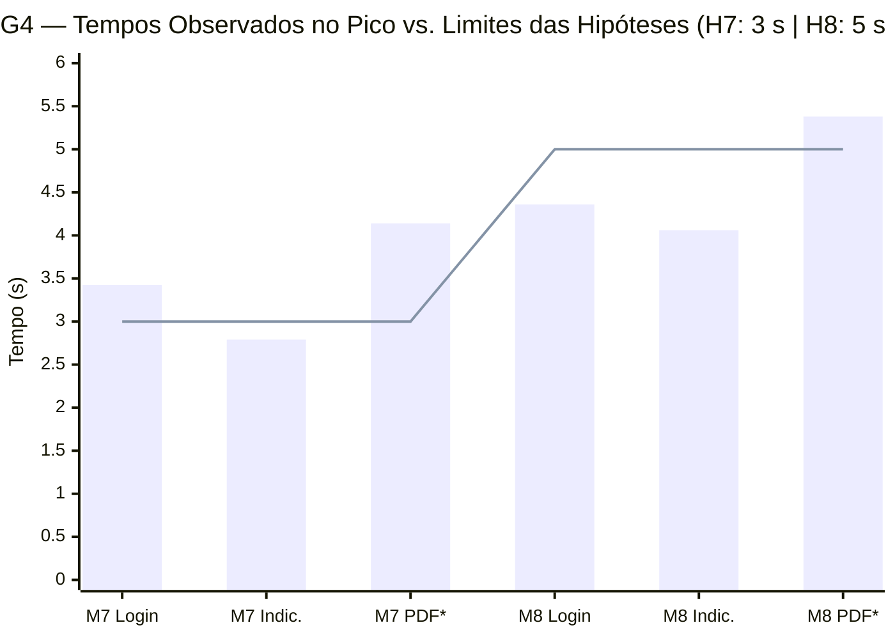

# Resultados de G4 — Eficiência de desempenho

Esta página apresenta os resultados do objetivo G4, que avalia o tempo de resposta do login e do painel de indicadores de continuidade e a variação de tempo entre os períodos de pico e fora de pico na 2ª via e no histórico de consumo.

As fórmulas, as faixas de pontuação e as quantidades mínimas são as definidas em [Métricas](../fase2/metricas.md) e nos [Critérios de julgamento](../fase2/criterios-julgamento.md). Os dados brutos estão relacionados em [Dados brutos e evidências](dados-brutos.md).

## M7 — Mediana do tempo de resposta

**Questão Q7:** Quanto tempo, normalmente, cada fluxo leva para ficar utilizável?

**Hipótese H7:** a mediana do tempo de resposta será de até 3 segundos em cada fluxo avaliado.

**Fórmula:** ordenar os tempos `t1, ..., tn` em ordem crescente; com `n` par, `Mediana = (t[n/2] + t[n/2 + 1]) / 2` (para `n = 10`, média entre o 5º e o 6º valor).

Os registros utilizados nas métricas M7 e M8 foram coletados em 19/11/2026, na janela de pico. Na Fase 2, esses indicadores consideram os fluxos de login/cadastro e de indicadores de continuidade. A geração do PDF da segunda via, incluída no roteiro D-01 da Fase 3, foi registrada como fluxo complementar.

Foram registradas dez durações concluídas em cada fluxo.

**Tabela 1 — Mediana por fluxo**

| Fluxo | n | 5º tempo (s) | 6º tempo (s) | Mediana (s) | Classificação |
|---|---:|---:|---:|---:|---|
| F1 — Login | 10 | 3,40 | 3,45 | **3,425** | Mínimo aceitável |
| F2 — Indicadores de continuidade | 10 | 2,67 | 2,91 | **2,790** | Alvo |
| F3 — PDF da segunda via (complementar) | 10 | 3,98 | 4,30 | **4,140** | Mínimo aceitável |

_Fonte: [M7-registros.csv](../dados-coleta/M7/M7-registros.csv), Equipe Radia Perlman, 2026._

**Cálculos:**

- **F1:** `(3,40 + 3,45) / 2 = 3,425 s`.
- **F2:** `(2,67 + 2,91) / 2 = 2,790 s`.
- **F3:** `(3,98 + 4,30) / 2 = 4,140 s`.

**Classificação:** **Mínimo aceitável** (menor nível entre os fluxos previstos no escopo da Fase 2: login e indicadores de continuidade; a medição complementar do PDF também ficou nesse patamar).

**Resultado da hipótese:** **H7 não sustentada** (o fluxo de login apresentou mediana de 3,425 s, acima do limite de 3 segundos).

**Análise:**

- No fluxo de indicadores de continuidade, o evento final observado foi a apresentação da mensagem “Unidade sem histórico de indicadores de continuidade”. O tempo registrado corresponde à exibição dessa resposta, e não ao carregamento de um painel com indicadores disponíveis.
- Além das dez durações de login, foram registradas **seis ocorrências sem tempo de conclusão informado**: três mensagens de solicitação não concluída e três respostas HTTP 403. Essas ocorrências estão identificadas separadamente no CSV e não foram tratadas como durações nem como timeouts de 30 segundos.
- **Resposta a Q7:** na janela de pico observada, o tempo típico (mediana) foi de **2,790 s** na abertura de Indicadores de Continuidade (dentro da meta de 3 s), **3,425 s** no Login (acima da meta) e **4,140 s** no fluxo complementar de geração do PDF da segunda via.

## M8 — Percentil 90 do tempo de resposta

**Questão Q8:** Qual é o comportamento das respostas mais demoradas?

**Hipótese H8:** o percentil 90 do tempo de resposta será de até 5 segundos em cada fluxo avaliado.

**Fórmula:** ordenar as durações em ordem crescente e selecionar o valor na posição `posto = ceil(0,90 × n)` (método do posto mais próximo). Com `n = 10` durações por fluxo, `posto = 9` (nono valor da série ordenada).

A M8 utiliza as mesmas durações concluídas da M7.

**Tabela 2 — Durações ordenadas (s)**

| Fluxo | Valores em ordem crescente |
|---|---|
| Login | 3,26; 3,27; 3,32; 3,39; 3,40; 3,45; 3,53; 3,93; 4,36; 4,96 |
| Indicadores de continuidade | 2,06; 2,20; 2,45; 2,46; 2,67; 2,91; 3,12; 3,45; 4,06; 4,30 |
| PDF da segunda via (complementar) | 3,71; 3,78; 3,79; 3,85; 3,98; 4,30; 4,31; 5,13; 5,38; 5,88 |

**Tabela 3 — Percentil 90 por fluxo**

| Fluxo | n | Posto | P90 (s) | Classificação |
|---|---:|---:|---:|---|
| F1 — Login | 10 | 9º | **4,36** | Alvo |
| F2 — Indicadores de continuidade | 10 | 9º | **4,06** | Alvo |
| F3 — PDF da segunda via (complementar) | 10 | 9º | **5,38** | Mínimo aceitável |

_Fonte: [M7-registros.csv](../dados-coleta/M7/M7-registros.csv) e [M8-registros.csv](../dados-coleta/M8/M8-registros.csv), Equipe Radia Perlman, 2026._

**Classificação:** **Alvo** (no escopo da Fase 2: login e indicadores de continuidade).

**Resultado da hipótese:** **H8 sustentada** (P90 ≤ 5 segundos em ambos os fluxos previstos na Fase 2).

**Análise:**

- Nos fluxos de login (4,36 s) e indicadores de continuidade (4,06 s), o P90 manteve-se abaixo do limite de 5 segundos.
- No fluxo complementar de geração do PDF, o P90 atingiu **5,38 segundos**, classificado como Mínimo aceitável. A inclusão desse fluxo no julgamento conjunto resultaria em classificação Mínimo aceitável, sem sustentação de H8.
- **Resposta a Q8:** nos fluxos previstos na Fase 2, mesmo as respostas mais demoradas (P90) permaneceram dentro do limite aceitável de 5 segundos (**4,36 s** no Login e **4,06 s** nos Indicadores de Continuidade), sustentando H8; apenas a geração complementar do PDF ultrapassou esse patamar (**5,38 s**).

## M14 — Razão de tempo entre pico e fora de pico

**Questão Q14:** A geração de PDF e de gráficos se mantém aceitável no horário de pico?

**Hipótese H14:** a mediana no pico será no máximo 1,5 vez a mediana fora do pico em cada fluxo avaliado.

**Fórmula:** `M14(f) = mediana no pico / mediana fora do pico`, calculada separadamente para cada fluxo `f` (`C-F1` e `C-F2`).

A coleta válida da M14 contempla o fluxo **C-F1 — Geração do PDF da segunda via**, na janela de pico de 19/11/2026, entre 09:45 e 09:47. Foram registradas dez durações concluídas.

**Tabela 4 — C-F1 na janela de pico**

| Durações ordenadas (s) | 5º tempo (s) | 6º tempo (s) | Mediana do pico (s) |
|---|---:|---:|---:|
| 3,65; 3,70; 3,71; 3,73; 3,99; 4,04; 4,11; 4,18; 4,26; 4,32 | 3,99 | 4,04 | **4,015** |

A mediana da janela de pico corresponde a `(3,99 + 4,04) / 2 = 4,015 s`.

**Classificação:** **Inconclusiva** (ausência de linha de base válida fora de pico para o cálculo da razão).

**Resultado da hipótese:** **H14 inconclusiva**.

**Análise:**

- Os registros submetidos para a janela fora de pico (Bloco 3) foram descartados durante a auditoria de qualidade da equipe por não atenderem aos critérios de confiabilidade e evidenciamento do protocolo, permanecendo válidos apenas os dados da janela de pico (Bloco 4).
- Sem a série fora de pico, não há valor calculável para a razão `M14(C-F1)`, tornando a métrica M14 e a hipótese H14 definitivamente inconclusivas.
- Além disso, o fluxo **C-F2**, originalmente associado à renderização do gráfico do histórico de consumo, não pôde ser executado porque a interface real do portal apresenta apenas uma tabela estática de leituras e valores, não dispondo de gráfico interativo.
- **Resposta a Q14:** inconclusiva. Embora a geração do PDF da 2ª via no horário de pico tenha apresentado mediana de **4,015 s**, o descarte da série fora de pico na auditoria interna impediu o cálculo da razão de degradação para C-F1, e a ausência de gráfico interativo no portal inviabilizou a avaliação de C-F2.

_Fonte: [M14-registros.csv](../dados-coleta/M14/M14-registros.csv) e [captura de geração do PDF](../evidencias/M14/segundaVia-pdf-pico-20261119-arthur.jpeg), Equipe Radia Perlman, 2026._

## Síntese do objetivo G4

**Tabela 5 — Consolidação das métricas e hipóteses de G4**

| Métrica | Resultado | Classificação | Hipótese |
|---|---|---|---|
| M7 — Mediana do tempo de resposta | F1: 3,425 s · F2: 2,790 s *(F3 complementar: 4,140 s)* | Mínimo aceitável | H7 não sustentada |
| M8 — Percentil 90 do tempo de resposta | F1: 4,36 s · F2: 4,06 s *(F3 complementar: 5,38 s)* | Alvo | H8 sustentada |
| M14 — Razão pico / fora de pico | C-F1 pico: 4,015 s *(sem série fora de pico válida; C-F2 inaplicável)* | Inconclusiva | H14 inconclusiva |

*Figura 1 — Comparação entre os tempos observados na janela de pico (barras) e os limites máximos previstos nas hipóteses H7 e H8 (linha de meta). Fluxos marcados com asterisco (*) correspondem à medição complementar de geração do PDF.*

Conforme a regra de consolidação da Fase 2 (presença de métrica inconclusiva no objetivo), o julgamento final de **G4 — Eficiência de desempenho** encerra como **Inconclusivo**, em razão da ausência de dados auditados na janela fora de pico para o cálculo da razão da M14. Os resultados válidos de M7 e M8 descrevem o comportamento temporal observado na janela de pico de 19/11/2026, sem extrapolação para outros períodos de operação da Agência Virtual.

## Ambiente e evidências das medições de 19/11/2026

As medições de M7, M8 e M14 apresentadas acima utilizaram um Dell Inspiron 15 3511 (Intel Core i5-1135G7, 8 GB de RAM), Fedora Linux 44 (Sway Spin), Mozilla Firefox e Wi-Fi de 5 GHz, sem VPN. A versão numérica do Firefox e a condição de cache não constam dos registros. As evidências de M7 e M8 estão reunidas em `docs/evidencias/M7-M8/` e relacionadas em [Dados brutos e evidências](./dados-brutos.md).

## Histórico de Versões

| Versão | Data | Descrição da Alteração | Autor(a) |
| --- | --- | --- | --- |
| 1.0 | 21/11/2026 | Criação da estrutura da página | Beatriz |
| 1.1 | 22/11/2026 | Inclusão dos cálculos e resultados de M7, M8 e M14 | Arthur de Lima Sobreira |
| 1.2 | 23/11/2026 | Inclusão da justificativa da ausência do fluxo C-F2 (interface em tabela estática, sem gráfico interativo) | Dara Maria Barbosa de Sousa |
| 1.3 | 24/11/2026 | Formalização do status inconclusivo definitivo de M14 e G4 após descarte da série fora de pico (Bloco 3) na auditoria interna | Dara Maria Barbosa de Sousa |
| 1.4 | 24/11/2026 | Explicitação das questões e hipóteses GQM (Q7, Q8 e Q14), respostas diretas às questões e gráfico comparativo dos tempos de resposta (critério F4-C3) | Dara Maria Barbosa de Sousa |
| 1.5 | 24/11/2026 | Correção de links | Henrique Martins Alencar |

