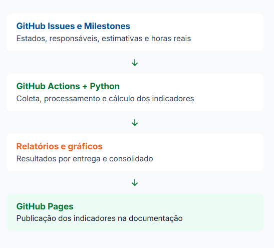

# Automação da Coleta de Métricas

Para eliminar o levantamento manual de dados e garantir rastreabilidade contínua, implementamos um pipeline automatizado utilizando **GitHub Actions**, **Python** e a **API REST do GitHub**.

## Arquitetura dos Arquivos

Os componentes responsáveis pela coleta, cálculo e geração de relatórios estão estruturados no repositório da seguinte forma:

```text
.github/
└── workflows/
    └── metricas-psm.yml      # Definição dos gatilhos e execução no GitHub Actions

scripts/
└── coletar_metricas_psm.py   # Consulta à API, cálculo dos indicadores e geração de gráficos
```

## Fluxo de execução 




O fluxo ilustrado na Figura 1 resume o ciclo completo executado pela automação sem necessidade de intervenção manual nos relatórios:

1. **GitHub Issues e Milestones:** Atuam como a fonte primária de dados, onde a equipe registra os estados das tarefas, responsáveis, estimativas e apontamentos de horas reais.
2. **GitHub Actions + Python:** O workflow `metricas-psm.yml` aciona o script `coletar_metricas_psm.py`, que consulta a API REST do GitHub, valida os registros e calcula os indicadores **PSM-1**, **PSM-2** e **PSM-3**.
3. **Relatórios e gráficos:** Os resultados são estruturados na pasta `relatorios/psm/` em arquivos Markdown, JSON e gráficos PNG, separados entre `entrega_1`, `entrega_2` e `consolidado`.
4. **GitHub Pages:** Por fim, o script `publicar_psm_docs.py` transfere os artefatos gerados para `docs/fase2/psm/`, atualizando automaticamente a página de resultados na documentação do MkDocs.

## Histórico de Versões

| Versão | Data | Descrição da Alteração | Autor(a) |
|---|---|---|---|
| 1.0 | 22/11/2026 | Separação da documentação técnica da automação em página própria | [Isabella Choukaira](https://github.com/isabellachoukaira) |
