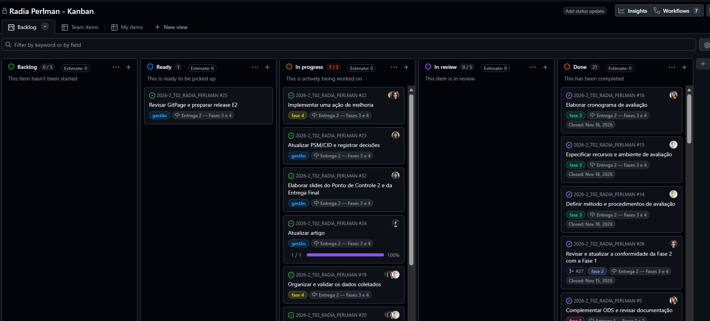

# Organização das Atividades

Todas as atividades do projeto são centralizadas no **GitHub Issues** e acompanhadas visualmente por meio do **GitHub Projects**. Essa padronização permite tanto a visualização clara das responsabilidades e do andamento pela equipe quanto a extração automatizada de dados para os indicadores PSM/CID.

## Quadro Kanban (GitHub Projects)

Para acompanhar o progresso diário sem a formalidade de Sprints, a equipe utiliza um quadro no **GitHub Projects** estruturado no modelo **Kanban de 4 colunas**:

1. **Backlog / A Fazer:** Tarefas mapeadas e vinculadas ao Milestone da entrega, aguardando início.
2. **Em Andamento / In Progress:** Atividades com responsável atribuído e em execução ativa.
3. **Em Revisão / Review:** Entregas concluídas pelo autor, aguardando revisão de outro integrante antes do fechamento.
4. **Concluído / Done:** Tarefas revisadas, integradas à documentação e com a respectiva Issue fechada.



## Estrutura Padrão de uma Issue

Para que o script `coletar_metricas_psm.py` leia e contabilize os dados sem erros (`linhas_de_horas_invalidas`), todas as Issues seguem quatro elementos obrigatórios:

1. **Título e Descrição:** Definição clara do artefato a ser produzido ou revisado.
2. **Assignee (Responsável):** Todo item em execução deve possuir ao menos um integrante atribuído.
3. **Milestone:** Vínculo obrigatório com `Entrega 1 — Fases 1 e 2` ou `Entrega 2 — Fases 3 e 4`.
4. **Seções de Esforço no Corpo da Issue:** Cabeçalhos de nível 2 (`##`) ou nível 3 (`###`) exatamente com os nomes `Estimativa (horas)` e `Horas reais`.

### Template para Copiar no Corpo da Issue

```markdown
## Descrição
[Descreva brevemente o que precisa ser feito e o arquivo da documentação relacionado]

## Estimativa (horas)
4

## Horas reais
- 22/11/2026 - Isabella Choukaira - 2.5h
- 23/11/2026 - Nome do Integrante - 1.5h

## Boas Práticas Acordadas pela Equipe

* Sempre revisar o documento de outro integrante antes de fechar a Issue.
* Manter os campos `Estimativa (horas)` e `Horas reais` preenchidos antes do encerramento da Issue para evitar valores `N/A` no relatório consolidado.

## Histórico de Versões

| Versão | Data | Descrição da Alteração | Autor(a) |
|---|---|---|---|
| 1.0 | 22/11/2026 | Documentação do fluxo de Issues e padrões de apontamento de horas | [Isabella Choukaira](https://github.com/isabellachoukaira) |